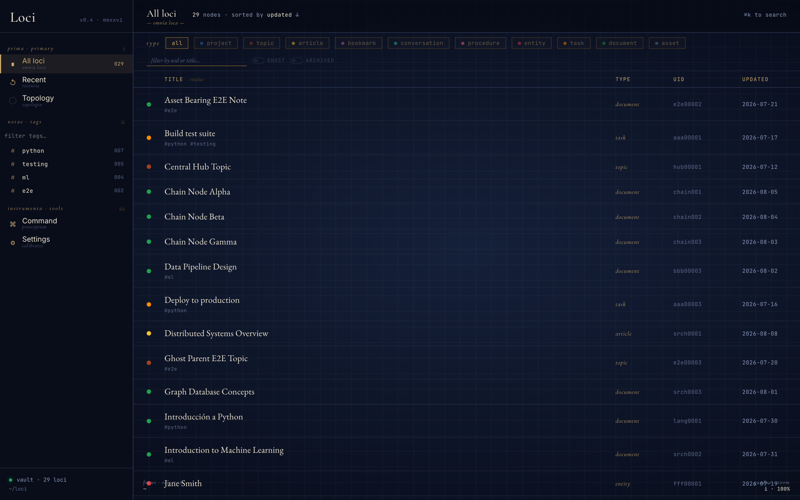
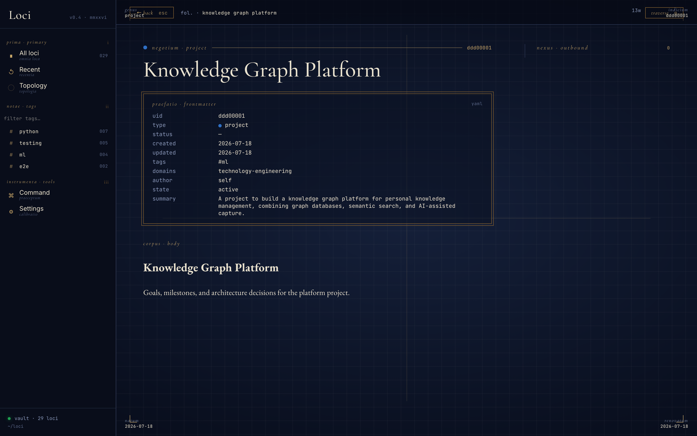
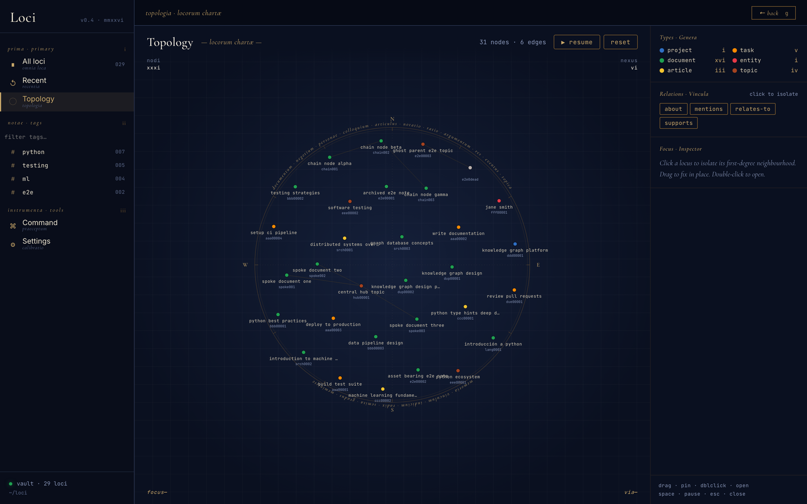
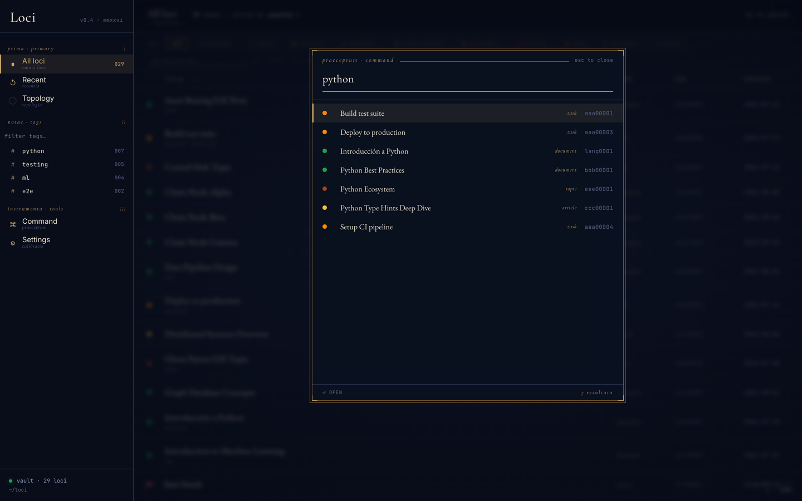

<div align="center">

<picture>
  <source media="(prefers-color-scheme: dark)" srcset="docs/images/monogram-dark.svg">
  
</picture>

<br/>


<!--
  These are static badges. The live ones (CI result, latest release, licence,
  coverage) cannot work yet: gked/loci is private, so both the GitHub Actions
  badge endpoint and shields.io return 404 to the anonymous fetch that renders
  a README image. Verified, not assumed.

  When the repo goes public (vault task 72c0063f), swap the first badge for:

  [](https://github.com/gked/loci/actions/workflows/test.yml)
  [](LICENSE)

  The licence badge needs a LICENSE file first; there isn't one.
-->

<br/>

</div>

***Loci*** /ˈloʊsaɪ/ (LOH-sy, or LOH-kee the way a Roman would have said it) is
Latin for "places," the plural of *locus*. The name comes from the method of
loci, the classical memory technique where you store what you want to remember
by putting it somewhere: a room, a road, a building you already know by heart.
You retrieve it by walking back through.

This project builds that space for your digital life. Everything you read,
write, save, and think about lives in one set of plain text files, simple enough
for an AI tool to reason over and readable by you in any editor.

Like the technique it borrows from, these files are more than captures of your
own thoughts and other people's. They also point outward, to assets in the
digital and physical world: a PDF on a drive, a book on a shelf, a message in an
inbox. The file records where the thing is, so you don't have to move everything
into one folder to keep track of it.

The goal is one place where your mental activity accumulates, so you can connect
the dots, find links you weren't looking for, and keep all of it in a form no
platform owns.

---

## The Problem

**Knowledge and content are fragmented across apps, devices, cloud accounts, and formats. There is no unified place where intellectual output (things read, produced, saved, researched, or thought) is captured, organized, and retrievable.**

Notes in one app, articles in a read-later queue, bookmarks in the browser, decisions buried in chat logs, ebooks in a folder, PDFs on a cloud drive, tasks somewhere else. Each tool owns its own schema and none of them link to each other. The connection between the book you read in March, the note you wrote about it in June, and the project it changed in September exists only in your head, and only until you forget it.

That shows up as six distinct failures:

**Ingestion.** No reliable way to capture content from arbitrary apps, devices, or contexts into a single store.

**Organization.** No consistent structure for tagging, categorizing, or linking related content. "AI", "ai", and "machine-learning" become three different tags; nothing stops the fourth.

**Retrieval.** No way to query across everything you've saved. Search matches strings, so it finds the note you already remembered, not the one you forgot.

**Reflection.** No way to see how your thinking on a topic has changed. You can find what you believe now, but not what you believed two years ago or what changed your mind.

**LLM accessibility.** Saved knowledge is not structured in a way that an LLM can reason over. An agent dropped into an unstructured folder re-derives the schema on every question, guesses what fields mean, and invents its own vocabulary on write, so the vault drifts a little further from itself each session.

**Memory.** There is no concept of a human digital memory that sits independently outside AI systems. Everything you tell an assistant lives in that assistant's store, on that vendor's terms.

### Why the obvious answers fall short

**A folder of Markdown** fixes lock-in and nothing else. Without stable identifiers, renaming a file breaks every reference to it. Without a declared vocabulary, tags drift. Without typed edges, "related to" means everything and therefore nothing. The result is searchable but not navigable.

**A database or a PKM app** fixes the structure and takes back the ownership: proprietary storage, no `grep`, no `git log`, no editing a file in your own text editor, and an export button you'll never have to trust until the day you do.

Loci's position is that you shouldn't have to choose. The Markdown file is always the source of truth. The graph is a query engine built on top of it, not a second store that can disagree with it.

### Doing the ontology on purpose

The moment you decide what a tag means, which relationships exist, and what makes two notes "related" rather than one being "part of" the other, you are doing ontology. The only real choice is whether you do it consciously or by accident.

| Formality | Approach | Where |
|---|---|---|
| Lightweight | Tags and a handful of link types | Obsidian, Roam |
| **Mid-weight** | **Typed nodes with defined fields, typed edges with defined semantics** | **Loci** |
| Heavy | Full OWL/RDF with an inference engine | Academic knowledge graphs |

Loci sits in the middle on purpose: enough structure for an LLM to reason over the graph, not so much that maintaining it becomes the hobby. Types, fields, relations, and storage schemes are declared in versioned YAML registries that both you and your agents are held to, validated on write and linted after.

### What that buys you

| Failure mode | Loci's answer |
|---|---|
| Scattered across silos | One vault. Notes, articles, tasks, books, people, and conversations are all nodes in the same graph. |
| Renaming breaks references | Every node has a stable 8-character UID. Links point at UIDs, never filenames. |
| "Related to" means nothing | A registry of 27 typed relations (`depends-on`, `contradicts`, `supersedes`, …). Unknown relations are rejected on write. |
| Vocabulary drift | Types, fields, relations, and location schemes live in versioned registries. `lint_vault` catches whatever slips through. |
| Files scattered across drives | A node records *where* a file is (`local`, `google-drive`, `nextcloud`, `url`, `gmail`, `s3`, …) instead of forcing you to copy everything into one place. |
| Agents that guess | Loci ships as an MCP server with skills. Claude reads the ontology before writing, so it uses your vocabulary rather than inventing one. |
| Thinking that leaves no trace | `supersedes`, `version-of`, and `is-based-on` edges, plus `log` nodes, record how a position changed rather than silently overwriting it. |
| Lock-in | Markdown in a directory you chose. Delete Loci tomorrow and the vault still opens in any editor. |

A vault is only as smart as its edges. Content without relationships is just storage, so edges get recorded at capture time by an agent that suggests links and asks you to confirm them, rather than left as a cleanup task you never get to. What that opens up is questions you couldn't ask a folder: *what do I know about stoicism?* returns the books, the reading logs, the notes, the people, and the paths between them.

---

## The Name

Past the memory technique, the word keeps the same spatial sense wherever it turns up. In mathematics a *locus* is the set of all points satisfying a condition. In genetics it is a fixed position on a chromosome where a gene lives. In *locus classicus*, the authoritative passage on a subject, the root still points at one specific, defined place.

Every note, article, task, and conversation you save gets a fixed location of its own: a stable UID, typed relationships, semantic metadata. You and your agents navigate it the way a memory palace is navigated, by association, by position, by path.

---

## What is Loci?

Loci is a personal knowledge management system built on plain Markdown files with YAML frontmatter, organized as a traversable knowledge graph. Both you and LLM agents (Claude Code, Claude Desktop, Claude.ai) can read and write it.

It has three faces over one vault:

- **An MCP server.** 33 tools for writing, patching, linting, and traversing the graph, plus versioned skills that teach Claude how to use them.
- **A local web app.** A React UI over a FastAPI backend for browsing the vault, filtering by type and tag, reading nodes, and walking the graph.
- **The files themselves.** Markdown you can open, edit, `grep`, and commit without any of the above running.

Every piece of content you save becomes a structured node with:
- A stable 8-character UID
- Typed relationships to other nodes
- Semantic metadata (tags, domains, summary)
- Optional asset locations (where the underlying file lives)

---

## Project status

Work in progress, and a personal one. The core is used every day; the edges are
uneven. What that means concretely:

| Area | State |
|---|---|
| Vault format, ontology, registries | Stable, in daily use |
| MCP server and skills | Stable, in daily use |
| Local (Python) setup | Stable, in daily use |
| Web UI | In daily use, read-only. No editing yet |
| Test suite (unit + browser e2e) | Runs on every push and PR |
| rclone sync | **Partial.** Manual script only, no scheduling or conflict handling, no tests |
| Docker | **Experimental.** Builds and runs, but lightly exercised and not in CI |
| Remote access (SSE + Cloudflare Tunnel) | **Unvalidated.** Written down, never stood up end to end |

Nothing is deprecated or abandoned; the weak spots are just unfinished. Each is
flagged again in its own section so you don't have to remember this table.

---

## Type System

Every vault node has a **type**. The right question when choosing one is not "what fields do I need?" but **"what question does this node answer?"**

| Type | The question it answers |
|---|---|
| `document` | What do I think or know about X? |
| `article` | What does this external source say? |
| `bookmark` | Where is this thing? |
| `conversation` | What did we discuss? |
| `project` | What am I working on? |
| `task` | What do I need to do? |
| `event` | What happened, and when? |
| `entity` | Who or what is this real-world actor? |
| `procedure` | How do I do X? |
| `topic` | What organizes this domain? |
| `asset` | What do I own? |
| `log` | What was my experience of engaging with X? |

**The common mistake:** thinking "this node has text, so it must be document-like." All vault nodes can have a text body. That is not what defines the type.

`document` is a **composition**: something that stands alone and matures over time (`status: draft → evergreen`). `log` is a **record**: it cannot exist without a subject (`subject_uid`), it doesn't mature, it completes. A reading log has text. So does a task description. Neither is a document.

### Type or tag?

The type list is short, and stays short because a candidate has to earn its place. Three questions, and a new type must answer **yes to at least one**:

1. Does it have fields no other type has?
2. Will you query for it exclusively, in ways you'd never query other types?
3. Does it behave differently in the system (display, ingestion, validation, relationships)?

If all three are no, it's a tag. This is why `recipe`, `workout`, and `playbook` are all `procedure` with a tag, and why `book` is `asset` with `subtype: book` rather than a type of its own.

Types can declare **subtypes** that add fields (e.g. `asset` / `subtype: book` adds `genre` and a body template). User-defined types extend a canonical parent and are registered in `ontology-user.yaml`; they inherit all parent fields and can add new ones, one level deep.

### Relations

Edges are typed, directional, and drawn from a closed vocabulary of 27 relations in six groups:

| Group | Relations |
|---|---|
| `dependency-sequencing` | `depends-on`, `enables` |
| `structural-ownership` | `belongs-to`, `parent-of`, `is-part-of`, `has-part` |
| `provenance-derivation` | `is-based-on`, `same-work-as`, `supersedes`, `version-of`, `implements` |
| `semantic` | `about`, `mentions`, `influences`, `supports`, `contradicts`, `inspired-by`, `informs`, `informed-by`, `references`, `involves`, `instance-of`, `used-in`, `uses` |
| `entity` | `works-at`, `follows` |
| `generic` | `relates-to` (weak-association fallback) |

Inverses are collapsed: store one directed edge and derive the reverse rather than writing both. For `depends-on` / `enables`, the edge lives on the dependent node. Anything outside this vocabulary is rejected on write; add your own to `relation-dictionary-user.yaml` via `define_relation` first.

---

## Setup: Local (Python)

Runs the MCP server directly on your machine. This is the path in daily use and
the one to start with.

**Requires:** Python 3.13+, [uv](https://docs.astral.sh/uv/), [rclone](https://rclone.org/) (optional, for backup), Node 20+ (optional, for the web UI)

### 1. Clone the repo

```bash
git clone https://github.com/gked/loci.git
cd loci
```

### 2. Initialize

```bash
uv run setup.py
```

This will:
- Install dependencies via uv
- Ask where the vault should live (default: `vault/` inside the project)
- Ask which rclone remote to use, if you want one
- Create the vault folder structure and seed meta dictionaries
- Register the MCP server with Claude Code and Claude Desktop

### 3. Configure a remote (optional)

```bash
cp sync/rclone.conf.sample ~/.config/rclone/rclone.conf
# edit with your credentials
```

Pull the vault from the remote on first setup:

```bash
./sync/sync.sh pull
```

Read [sync and backup](#sync-and-backup) before relying on this. It is a manual
script, not background sync.

### 4. Install the Loci skills in Claude Code

Symlink each skill into `~/.claude/skills/`:

```bash
for s in loci-save loci-query loci-inbox loci-ingest-directory; do
  ln -sfn "$PWD/server/skills/$s" ~/.claude/skills/"$s"
done
```

> **Note:** `setup.py` also tries to install the skills, but still looks for them
> under a `loci-skill/` directory that no longer exists, so it leaves dangling
> symlinks. Use the loop above until that's fixed. The Docker wizard
> (`setup_docker.py`) reads the correct `server/skills/` path, but only installs
> `loci-save` and `loci-query`.

### 5. Restart the MCP server

For Claude Desktop, the server is managed by the app, so just quit and reopen it. For Claude Code, restart the session or toggle the MCP connection. To run the server by hand:

```bash
./run_server.sh
# or directly:
uv run python server/loci_mcp/server.py
```

### 6. Test it

Open Claude Code and say:

```
Save this to my loci vault as a note: Loci is now set up and working.
```

---

## Setup: Docker (experimental)

> **Lightly tested.** The local Python setup above is the path actually in daily
> use. Docker works in principle and the compose file is kept current, but it
> has not been exercised much, so expect rough edges. Nothing here is covered by
> the test suite.

Docker handles dependencies inside the container and adds an optional daily
backup. See [sync and backup](#sync-and-backup) for what that does and does not
cover.

### 1. Clone the repo

```bash
git clone https://github.com/gked/loci.git
cd loci
```

### 2. Run the setup script

```bash
uv run setup_docker.py
```

The script will:
- Check for Docker or OrbStack, and offer to install one via Homebrew if neither is found
- Ask where the vault should live
- Optionally point rclone at a remote for the daily backup (Nextcloud, Dropbox, Google Drive, S3, and more)
- Build the image and start the container
- Symlink the Loci skills into `~/.claude/skills/`
- Verify the server is responding

### 3. Restart Claude Code

The setup script installs the skills automatically. Restart Claude Code to pick them up.

### 4. Test it

Open Claude Code and say:

```
Save this to my loci vault as a note: Loci is now set up and working.
```

### How Docker and the vault interact

The vault is **not inside the container**. Docker runs the MCP server process and, if configured, the daily backup loop. Your vault data lives on the host filesystem and is mounted into the container at `/knowledge-vault` at runtime. This means:

- Vault data persists across container restarts and rebuilds
- You can stop, update, or replace the container without touching your notes
- The same vault can be used by the local stdio server (Claude Code / Claude Desktop) and the Docker SSE server simultaneously

Your rclone config is mounted in read-only from the host, so credentials are never baked into the image.

### Managing the container

**Terminal:**

```bash
# Restart (no rebuild)
docker compose -f deploy/docker-compose.yml restart

# Rebuild after code changes
VAULT_PATH=/absolute/path/to/knowledge-vault docker compose -f deploy/docker-compose.yml up -d --build

# Stop
docker compose -f deploy/docker-compose.yml down

# View logs
docker compose -f deploy/docker-compose.yml logs -f
```

**OrbStack:**

Open the OrbStack app and the `loci` container appears in the sidebar. From there you can restart, stop, or view logs with a single click without needing the terminal.

---

## Sync and backup

**There is no automatic sync.** What exists is a thin rclone wrapper you run
yourself, plus an optional one-way backup loop in the Docker container. Treat
multi-device use as unfinished.

`sync/sync.sh` takes a direction and shells out to rclone:

```bash
./sync/sync.sh push     # local vault  ->  remote  (rclone sync)
./sync/sync.sh pull     # remote       ->  local   (rclone sync)
./sync/sync.sh bisync   # two-way      (rclone bisync)
```

Things to know before trusting it:

- **`push` and `pull` are mirrors, not merges.** Both call `rclone sync`, which
  makes the destination match the source. A `pull` overwrites local changes the
  remote hasn't seen; a `push` does the reverse. There is no conflict handling.
- **`bisync` needs seeding.** The first run has to be
  `rclone bisync <local> <remote> --resync` by hand, and it is the least
  exercised path here.
- **Nothing runs on a schedule locally.** No watcher, no daemon, no hook. If you
  don't run the script, nothing moves.
- **The Docker container backs up, it does not sync.** With `BACKUP_REMOTE` set,
  `deploy/entrypoint.sh` runs a one-way `rclone sync` from the vault to the
  remote every `BACKUP_INTERVAL` seconds (default daily). It never pulls.
- **None of this is covered by tests.** The suite does not touch rclone.

If you need the vault on more than one machine today, the more reliable option
is to put it inside a folder your existing sync client already manages
(Nextcloud, Dropbox, iCloud Drive) and leave `sync.sh` alone.

---

## Remote Access (Claude.ai / mobile, unvalidated)

> **Never verified end to end.** This is a written-down plan, not a tested
> procedure. The scripts and templates exist and the SSE transport is
> implemented, but nobody has stood the whole thing up and confirmed a client
> connects. It builds on the experimental Docker path and has no test coverage.
> Expect to debug it.

The intent: run the MCP server on a Linux home lab server and expose it via Cloudflare Tunnel, so Claude.ai, Claude Desktop, or mobile can reach it. No open ports, no domain required.

```bash
bash deploy/setup-homelab.sh
```

The script installs Docker, rclone, and cloudflared; creates a named tunnel; and starts the container. Once running:

- **Claude Desktop / Claude Code:** `claude mcp add --transport sse loci <tunnel-url>/sse --scope user`
- **Claude.ai / mobile:** Settings → Connectors → Add custom connector → `<tunnel-url>/sse`

The vault lives on the server and is the single source of truth. All clients connect to the same endpoint. Nextcloud backup runs daily if `BACKUP_REMOTE` is configured in `deploy/.env`.

**Authentication:** after setup, protect the tunnel with [Cloudflare Zero Trust Access](https://one.dash.cloudflare.com): Access → Applications → Add Self-hosted app → policy: your email. Without this the endpoint is open.

Server env vars (`server/loci_mcp/server.py`):

| Var | Meaning |
|---|---|
| `LOCI_TRANSPORT` | `stdio` (default) or `sse` |
| `LOCI_VAULT_ROOT` | Path to the knowledge vault, overriding `config.yml` |
| `LOCI_PORT` | SSE only, default `8000` |
| `LOCI_TOKEN` | SSE only, optional bearer auth |

---

## Usage

Describe what you want to save, and **say "loci" or "my vault" in the request**:

```
Save this to my loci vault as a note: ...
Add this article to loci: https://example.com/article
Create a task in my vault: Review the Loci architecture by Friday
Save this entity to loci: John Smith, CEO at Acme Corp
```

Naming the vault matters. Claude picks a skill from what you asked for, and a
bare "save this as a note" is ambiguous enough to land in a scratch file, a
different notes tool, or nowhere. Mentioning loci or the vault routes it to the
`loci-save` skill, which reads the ontology, classifies the type, generates
frontmatter, suggests entity links, and writes the file.

### Querying

Same rule when reading back:

```
What does my loci vault know about stoicism?
What's connected to the Loci project in my vault?
What did I save to loci in the last two weeks?
How are these two vault notes related?
```

The `loci-query` skill uses the graph tools (`query_neighbors`, `query_related`, `query_path`, `find_nodes`, `search_vault`, `query_recent`, `query_insights`) rather than grepping files.

### Library

Track your ebook library as a knowledge graph. Books are saved as `asset` nodes with `subtype: book`; each time you read one, a `log` node (tagged `reading`) captures your notes, highlights, and rating, separately per reading, so re-reads are tracked independently.

```
Save this ebook to my loci library: Thinking, Fast and Slow by Kahneman
Log a reading in loci: I finished The Name of the Rose, 5/5, started March 1st
What does my vault know about stoicism? (finds books, reading logs, and connected topics)
```

### Inbox

Drop files into `loci-stage/` and run the inbox skill to process them in batches:

```
Process my loci inbox
```

The agent scans the staging folder, presents a plan with cost/time estimates, waits for your approval, then ingests files in configurable batch sizes (default: 50 ebooks per run, 10 text items per run; adjust `DEFAULT_BUDGET_FILES` / `DEFAULT_BUDGET_CONTENT` in `server/tools/inbox_plan.py`). Progress is saved to `.inbox-plan.yaml` so sessions can be interrupted and resumed.

### Ingesting a directory in place

```
Ingest ~/Documents/papers into my loci vault
```

`scan_directory` catalogues files where they already live and the `loci-ingest-directory` skill creates nodes whose `has_asset` locations point at the original paths. Nothing is copied or moved.

---

## The vault UI

A local React app for browsing the graph. Start both halves with one command:

```bash
make dev          # API on :8765 + Vite dev server on :5173
```

The backend is `server/http_server.py`, a thin FastAPI layer over the same `server/api.py` facade the MCP server uses, so the UI can never drift onto a separate code path. It is read-only today (the API allows `GET` only); writes go through Claude.

### Vault index

Everything in the vault, filterable by type along the top and by tag down the left rail. Each row carries its type dot, tags, uid, and last-updated date.



### Node reader

Frontmatter rendered as a labelled grid rather than raw YAML, with the Markdown body below it. Nodes carrying an asset also show its resolved location and, for small text files, its inlined content.



### Topology

The graph as a force-directed map, coloured by type and filterable by relation. Click a node to isolate its first-degree neighbourhood, drag to pin, double-click to open. Space pauses the simulation.



### Command palette

`⌘K` from anywhere. Searches titles and summaries, showing type and uid per hit.



> These are captured from the e2e fixture vault, not a real one. `make screenshots` regenerates them.

---

## Vault Structure

The vault is **flat**: every node is a Markdown file at the vault root, named by a slug of its title (`why-i-left-twitter.md`). There are no per-type folders; type is frontmatter, and the graph index does the organizing. The only subdirectory is `meta/`.

```
~/Nextcloud/loci/                    ← loci root (all stores are siblings)
  knowledge-vault/                   ← knowledge graph, markdown only
    <slug>.md                        ← one file per node, flat
    meta/
      ontology.yaml                  ← machine-readable type system   (reseeded on META_VERSION bump)
      ontology-user.yaml             ← user-defined type extensions   (user-owned)
      relation-dictionary.yaml       ← machine-readable relations     (reseeded)
      relation-dictionary-user.yaml  ← user-defined relations         (user-owned)
      scheme-dictionary.yaml         ← location scheme vocabulary     (reseeded)
      scheme-dictionary-user.yaml    ← user-defined schemes           (user-owned)
      type-dictionary.md             ← human-readable type vocabulary (reseeded)
      field-dictionary.md            ← field definitions per type     (reseeded)
      tag-dictionary.md              ← freeform tag vocabulary        (reseeded)
      relation-dictionary.md         ← human-readable relation guide  (reseeded)
      foreign-definitions.md         ← external source schemas        (reseeded)

  assets/                       ← binary/rich files adopted into the vault
    <uid>.<ext>                 ← one file per asset, named by vault node UID
    .pending/                   ← intent files for crash recovery during writes

  loci-stage/                   ← staging inbox, drop files here for batch ingestion
    .inbox-plan.yaml            ← work queue written by scan_inbox, consumed by execution
```

`assets/` and `loci-stage/` are **siblings** of the vault, not inside it. The vault directory holds `.md` files only. See [docs/file-saving.md](docs/file-saving.md) for the full write sequence.

### Assets and locations

A node points at its underlying files through the `has_asset` frontmatter list. Each entry is a format with one or more candidate locations:

```yaml
has_asset:
  - format: epub
    primary: true
    locations:
      - scheme: local
        path: assets/56bb363e.epub
      - scheme: google-drive
        file_id: 1AbCdEf…
```

`resolve_asset` walks the locations in order and returns the first one that resolves. Schemes are declared in `scheme-dictionary.yaml` and validated on write; `local` and `url` fetch content directly, while cloud and remote schemes (`google-drive`, `nextcloud`, `gmail`, `onedrive`, `dropbox`, `icloud-drive`, `s3`, `ssh-remote`) resolve to a pointer that the appropriate MCP or native tool opens. `find_nodes(has_asset_scheme=…)` filters the graph by scheme.

This replaced the separate `asset-registry/` YAML store (locations refactor, Phase 5). Location data now lives in the node's own frontmatter. `vault_init` still creates a legacy `asset-registry/` directory, but nothing in the save path writes to it.

---

## Project Structure

```
loci/
  app/                              ← React + Vite frontend
    src/
      App.jsx
      components/                   ← VaultIndex, NodeDetail, GraphView, CommandPalette, …
      lib/api.js                    ← fetch layer for the FastAPI backend
    design/                         ← design system (tokens, assets, UI kit components)
      SKILL.md                      ← Claude's instructions for design work
      colors_and_type.css
      ui_kits/                      ← outer-shell, instrument-shell, inner-shell
      assets/

  server/
    api.py                          ← public facade, single entry point for all callers
    http_server.py                  ← FastAPI backend for the web UI
    loci_mcp/
      server.py                     ← MCP tool definitions and docstrings
    skills/
      loci-save/SKILL.md            ← saving content
      loci-query/SKILL.md           ← querying and traversal
      loci-inbox/SKILL.md           ← processing loci-stage/
      loci-ingest-directory/SKILL.md ← cataloguing a directory in place
      references/                   ← source of truth for vault/meta/ seed files
        ontology.yaml               ← type system (TypeRegistry source)
        ontology-user.yaml          ← user type extensions (seeded once, user-owned)
        relation-dictionary.yaml    ← relation vocabulary (RelationRegistry source)
        relation-dictionary-user.yaml ← user relation extensions (seeded once, user-owned)
        scheme-dictionary.yaml      ← location scheme vocabulary (SchemeRegistry source)
        scheme-dictionary-user.yaml ← user scheme extensions (seeded once, user-owned)
        type-dictionary.md          ← type selection guide
        type-decision.md            ← type decision flowchart
        field-dictionary.md         ← field guidance per type
        tag-dictionary.md           ← seed: initial tag vocabulary
        relation-dictionary.md      ← seed: typed edge vocabulary (human-readable)
        foreign-definitions.md      ← seed: external source schemas
    tools/                          ← core business logic
      uid_generator.py
      slug.py
      vault_init.py                 ← folder structure, meta seeding, META_VERSION
      write_file.py                 ← node writes + registry validation
      vault_linter.py               ← lint checks for vault nodes (incl. has_asset structure)
      nx_graph.py                   ← NetworkX in-memory graph index
      type_registry.py              ← TypeRegistry singleton (ontology.yaml)
      relation_registry.py          ← RelationRegistry singleton (relation-dictionary.yaml)
      scheme_registry.py            ← SchemeRegistry singleton (scheme-dictionary.yaml)
      resolvers/                    ← location scheme resolver layer
        base.py                     ← Resolver ABC (resolve / enumerate interface)
        dispatcher.py               ← routes locations to a resolver by scheme
        local_resolver.py           ← local filesystem
        url_resolver.py             ← http/https
        external_resolver.py        ← pass-through pointer for cloud/remote schemes
      asset_registry.py             ← asset path helpers + crash-recovery intent files
      metadata_extractor.py         ← epub OPF parsing, PDF metadata, filename fallback
      inbox_scanner.py              ← classify files in loci-stage/ by extension and location
      inbox_plan.py                 ← read/write/update .inbox-plan.yaml work queue
      directory_scanner.py          ← catalogue an arbitrary directory in place
    tests/
      conftest.py
      fixtures/vault/               ← base fixture vault (node files only, no meta/)
      fixtures/e2e-overlay/         ← extra nodes layered on top for e2e only
      test_*.py                     ← unit suite
      e2e/                          ← Playwright browser suite (see its README.md)

  .githooks/                        ← pre-commit / pre-merge-commit / pre-push (make hooks)
  .github/workflows/test.yml        ← CI: unit + e2e on every push and PR

  deploy/
    Dockerfile
    docker-compose.yml
    entrypoint.sh                   ← starts MCP server; optional daily backup to Nextcloud
    setup-homelab.sh                ← one-shot setup script for Linux home lab server
    loci-mcp.service                ← systemd service for always-on SSE server
    nginx.conf.sample               ← nginx config for SSE + Cloudflare

  docs/
    execution-flows.md
    diagrams.md
    file-saving.md                  ← assets/, loci-stage/, and the file→node pipeline
    testing.md

  sync/
    rclone.conf.sample              ← rclone remote config template
    sync.sh                         ← push/pull/bisync wrapper

  setup.py                          ← local setup wizard
  setup_docker.py                   ← Docker setup wizard
  run_server.sh
  config.yml                        ← local config (gitignored, see config.sample.yml)
  config.sample.yml
  Makefile
  pyproject.toml
  CLAUDE.md                         ← working rules for Claude in this repo
  README.md
```

---

## Development

### One-time per clone

```bash
make hooks          # install .githooks/, blocking direct commits/merges/pushes
make e2e-install    # download the Chromium binary for the browser suite
```

### Running

```bash
make dev            # API (:8765) + Vite dev server (:5173) together
make dev-api        # FastAPI only:  uv run uvicorn server.http_server:app --reload --port 8765
make dev-ui         # Vite only:     cd app && npm run dev
./run_server.sh     # MCP server in stdio mode (Claude Code / Claude Desktop)
```

### Testing

```bash
make test           # full suite: Python unit + browser e2e
make test-fast      # unit only (-m "not e2e"), no Node or browser
make test-e2e       # browser suite only
make test-cov       # unit suite with a coverage report
make screenshots    # recapture the README images from the e2e fixture vault
```

Tests point at a temp copy of `server/tests/fixtures/vault/` via the `LOCI_VAULT_ROOT` env var (set by the `tmp_vault` fixture in `conftest.py`), so your real vault is never touched. See [docs/testing.md](docs/testing.md) and [server/tests/e2e/README.md](server/tests/e2e/README.md).

### Contributing rules

`main` is never written to directly. Every change lands through a PR from a branch, and the git hooks enforce it locally. Every PR carries unit tests; anything that touches the UI also carries a Playwright e2e test. Both suites must be green before the PR opens. See [CLAUDE.md](CLAUDE.md) for the full working agreement, including the skill ↔ tool sync rule.

---

## Schema Versioning

Meta files are seeded into `vault/meta/` from `server/skills/references/`, which is the source of truth for what a fresh vault gets. `vault_init.py` holds the current `META_VERSION` (currently **7**) and two lists:

- `META_FILES`: reseeded on every `META_VERSION` bump
- `USER_META_FILES`: seeded once and never overwritten (the `-user.yaml` extension files)

`config.yml` tracks the `meta_version` the vault was last seeded at. On startup, a vault behind `META_VERSION` is reseeded and its config updated.

### Adding a new type, relation, scheme, or field (non-breaking)

1. Edit the relevant file in `server/skills/references/`
2. Increment `schema_version` in that file and `META_VERSION` in `vault_init.py`
3. Add the `read_meta` key in `api.py` and update the `server.py` docstring if it's a new file
4. Update any skill that should read or validate against it

### Breaking changes (rename, remove, restructure)

Breaking changes require an explicit migration script that reads the live vault, transforms affected nodes, and updates `meta_version` in `config.yml`. Document the change in a changelog entry.

### Why two copies?

The vault meta files are user-owned, accumulating customizations (new tags, local schema tweaks) that the project seeds don't have. The `server/skills/references/` files are the template. Non-breaking additions are auto-reseeded; breaking changes always require explicit migration.

---

## Roadmap

### Done

`[~]` marks something that exists and works, but is not finished or well tested.

- [x] Core vault structure and schema
- [x] `vault_init`, `uid_generator`, `slug`, `write_file` tools
- [x] MCP server: stdio transport, Claude Code / Claude Desktop integration
- [x] Patch and delete operations
- [x] Field dictionary: authoritative schema in vault meta, skill reads at runtime
- [x] Schema versioning: seed files in `server/skills/references/`, `meta_version` in `config.yml`
- [~] rclone wrapper: manual `push` / `pull` / `bisync` script, plus a one-way daily backup in Docker. No scheduling, no conflict handling, no tests
- [x] SSE transport: remote MCP server support (Claude.ai / mobile)
- [~] `deploy/`: Docker image, systemd + nginx templates, home lab setup script. Builds and runs, but lightly tested and uncovered by CI
- [x] Graph layer: NetworkX in-memory index for traversal and relationship queries
- [x] `loci-save` and `loci-query` skills
- [x] Type and relation registries: machine-readable ontology, validated on write, linted after
- [x] Assets: crash-safe write sequence, resolver layer, startup recovery
- [x] Library support: `asset` nodes with `subtype: book`; `log` canonical type (one per read, supports re-reads)
- [x] Inbox: `loci-stage/` staging folder, two-phase scan → execute, per-category budgets, resumable plan file
- [x] `scan_directory` + `loci-ingest-directory`: catalogue files where they already live
- [x] Locations refactor Phase 1: `has_asset` list schema, scheme dictionary, SchemeRegistry, local resolver + dispatcher, lint, `find_nodes` scheme filters
- [x] Locations refactor Phase 2: external scheme resolvers (`url`, `google-drive`, `nextcloud`, `gmail`, and the rest)
- [x] Locations refactor Phase 5: `asset-registry/` collapsed into `has_asset` frontmatter
- [x] Web UI: React + Vite app over a FastAPI backend: vault index, type/tag filters, node reader, graph view, command palette
- [x] Browser e2e suite: Playwright driving the real app against a real backend and vault
- [x] CI + git hooks: `main` protected locally and on GitHub, both suites run on every push

### Next
- [ ] Streamable HTTP transport (SSE is deprecated in the MCP spec)
- [ ] Retire the vestigial `asset-registry/` directory from `vault_init`
- [ ] Editing from the UI (currently read-only)
- [ ] Real sync: scheduling, conflict handling, and tests for the rclone layer
- [ ] Exercise the Docker and home lab paths properly, then drop the experimental label

### Later
- [ ] Vector DB: deferred until summaries exceed the context window. Revisit ChromaDB / LanceDB / Qdrant at that point
- [ ] Browser extension / bookmarklet
- [ ] Native mobile / desktop apps (local-first, SQLite backend)
- [ ] Telegram bot: bidirectional ambient interface

### Open questions
- Relationship inference: at what vault size does automatic inference become useful vs. noisy?
- Decay heuristics: what signals indicate a note is going stale?
- Journal privacy: separate encryption layer for private entries?
- Content editing model: edit in place, or new node linked via `supersedes` / `revisits`?
- History tracking: implicit (git log) or explicit (encoded in graph)?

---

## Design Decisions

Key decisions are documented in the Loci vault itself, in the requirements note for the project (`search_vault("locus requirements")`). If you are contributing or extending Loci, read that and [CLAUDE.md](CLAUDE.md) first.
