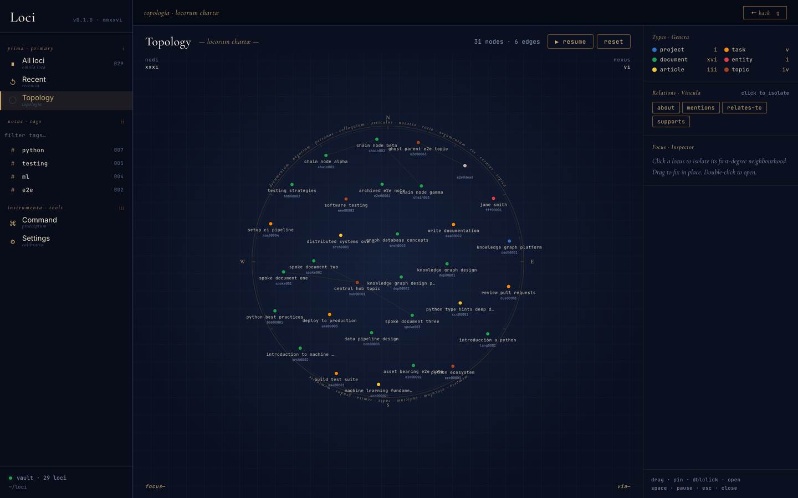

<div align="center">

<picture>
  <source media="(prefers-color-scheme: dark)" srcset="https://raw.githubusercontent.com/gked/loci/main/docs/images/monogram-dark.svg">
  
</picture>

<br/>
<br/>
<br/>

[](https://github.com/gked/loci/actions/workflows/test.yml)


[](https://github.com/gked/loci/blob/main/README.md) 

<br/>

</div>

# Loci

**Персональный граф знаний, которым владеете вы.** Loci хранит ваши заметки,
статьи, книги, задачи, людей и разговоры как обычные Markdown-файлы в папке,
которую выбираете вы. Ваш ИИ-агент читает и пишет эти файлы через MCP-сервер.
Локальный веб-интерфейс показывает их в виде графа.

**Проблема.** Ваши знания разбросаны по множеству приложений. Приложения не
связаны друг с другом. ИИ-ассистент хранит свою память на серверах вендора, в
формате вендора. При поиске вы находите только ту заметку, которую уже помните.

**Что делает Loci.**

- **Хранит всё в одном месте, в виде файлов.** Каждый элемент — один
  Markdown-файл с YAML frontmatter. Файлы можно открывать, искать через `grep`
  и коммитить без какого-либо другого ПО. Если вы удалите Loci, файлы останутся.
- **Связывает элементы типизированными связями.** У каждого элемента есть
  стабильный 8-символьный ID, тип (`article`, `task`, `entity`, …) и
  типизированные ссылки на другие элементы (`is-based-on`, `contradicts`,
  `supersedes`, …). Ссылки построены на ID, поэтому переименование их не
  ломает.
- **Держит агента в рамках вашего словаря.** Типы, поля и связи описаны в
  версионируемых реестрах. Loci отклоняет при записи неизвестный тип или
  связь. Агент читает реестры перед записью.
- **Указывает на файлы, а не перемещает их.** Элемент может хранить
  местоположение файла: на вашем диске, в Google Drive, по URL, в Gmail и т. д.
- **Записывает каждое изменение.** Loci ведёт историю каждой записи, в том
  числе правок, сделанных вами вручную.

**Для кого.** Вы пользуетесь ИИ-агентом каждый день (Claude Code поддерживается
полностью). Вам нужно одно место для всего, что вы читаете, пишете и решаете, в
формате, которым не владеет ни одна платформа.

Задавайте вопросы, на которые папка ответить не может: *что я знаю о
стоицизме?* вернёт книги, журналы чтения, заметки, людей и связи между ними.



**Статус.** Работа в процессе, личный проект. Автор пользуется ядром каждый
день. Некоторые части не закончены.
[Статус и дорожная карта](https://github.com/gked/loci/blob/main/docs/ru-RU/roadmap.md)
показывают, какие именно.

---

## Быстрый старт

**Требования:** macOS, Python 3.13+ и [uv](https://docs.astral.sh/uv/).
**Пока Loci поддерживает только macOS.** Автор использует его на macOS. CI
запускает тесты на Linux, но Linux не является поддерживаемой платформой, а
Windows не тестировался.

**1. Установите из PyPI**

```bash
uv tool install loci-vault
```

> **Пакет на PyPI называется `loci-vault`, а не `loci`.** Имя `loci` на PyPI
> занято посторонним проектом. Не запускайте `uv tool install loci` или
> `pip install loci`. Вы устанавливаете `loci-vault`; команды, которые он
> добавляет, — `loci` и `loci-mcp`.

**2. Подключите к агенту**

```bash
loci setup
```

Команда за один шаг устанавливает навыки и регистрирует MCP-сервер. Если Loci
находит одного агента (Claude Code или Hermes), он использует его. Если
находит нескольких, спрашивает, какого выбрать. Чтобы пропустить вопрос,
добавьте `--target claude`, `--target hermes` или `--target all`. Команду
безопасно запускать повторно.

Предпочитаете по отдельности? `loci skills` устанавливает навыки, а
`loci register` регистрирует сервер; `loci setup` — это обе команды с одним
вопросом. Про других агентов см. [Поддержка агентов](#поддержка-агентов).

**3. Выберите папку хранилища**

Перезапустите Claude Code. Затем скажите ему, где должно лежать хранилище:

```
Point Loci at ~/loci/vault
```

Берите папку, которая лежит на один уровень глубже собственной папки, как в
этом примере. Рядом с хранилищем Loci создаёт ещё две папки: `assets/` (файлы,
которые вы добавляете) и `loci-stage/` (входящие для пакетного импорта). Для
`~/loci/vault` все три окажутся в `~/loci/`. Для `~/vault` они попадут прямо в
вашу домашнюю папку.

**4. Пользуйтесь**

```
Save this article to my loci vault: https://example.com/post
What does my loci vault know about stoicism?
```

Чтобы просматривать хранилище, запустите веб-интерфейс:

```bash
loci        # opens on http://127.0.0.1:8765
```

| Команда | Что это |
|---|---|
| `loci` | Веб-интерфейс и его HTTP-бэкенд. Адрес меняется через `--host` / `--port` (или `LOCI_UI_HOST` / `LOCI_UI_PORT`). Завершается с ошибкой, если вы не выполнили шаг 3. |
| `loci-mcp` | MCP-сервер по stdio. Его запускает агент. Самостоятельно не запускайте. |

Про обновления, установку из чекаута и синхронизацию см.
[docs/ru-RU/setup.md](https://github.com/gked/loci/blob/main/docs/ru-RU/setup.md).

---

## Поддержка агентов

Loci — стандартный MCP-сервер. Его может использовать любой агент с поддержкой
MCP.

| Агент | Статус |
|---|---|
| Claude Code | Поддерживается полностью и протестирован. Шаги выше устанавливают всё. |
| Claude Desktop (macOS) | Поддерживается. Регистрирует `loci register` (или установка из чекаута, `uv run setup.py`). |
| Hermes | Поддерживается. `loci register --target hermes` и `loci skills --target hermes`. |
| DeepSeek Harness и другие агенты | Не тестировались. Ручная настройка, либо попросите агента настроить себя самого. [Шаги](https://github.com/gked/loci/blob/main/docs/ru-RU/setup.md#другие-агенты-deepseek-harness-и-прочие). |
| Codex и другие MCP-клиенты | Должны работать. Не тестировались. Выполните шаги ниже. |

Для агента, отличного от Claude Code:

1. Зарегистрируйте MCP-сервер в вашем агенте. Для Codex:
   `codex mcp add loci -- loci-mcp`. Для других агентов см. их документацию по
   MCP. Команда запуска — `loci-mcp`.
2. Если ваш агент поддерживает навыки (папки `SKILL.md`), установите навыки в
   его папку навыков: `loci skills --dir <folder>`. Для Codex это обычно
   `~/.codex/skills`.
3. Если агент не поддерживает навыки, добавьте в его инструкции такую строку:
   «Перед сохранением в Loci или чтением из него вызови инструмент `read_skill`
   MCP-сервера `loci` и следуй результату».

**Ваши данные и модель.** Хранилище остаётся на вашей машине. Когда агент читает
заметку, чтобы ответить вам, он отправляет её провайдеру своей модели — как и
любой другой файл, который агент читает.

---

## Документация

**Использование Loci**

| | |
|---|---|
| [Проблема](https://github.com/gked/loci/blob/main/docs/ru-RU/problem.md) | Зачем нужен Loci и почему папки с Markdown или PKM-приложения самих по себе недостаточно |
| [Установка и настройка](https://github.com/gked/loci/blob/main/docs/ru-RU/setup.md) | Установка из PyPI, из релизного wheel или из чекаута. Обновление. Синхронизация и резервные копии |
| [Примеры](https://github.com/gked/loci/blob/main/docs/ru-RU/examples.md) | По одному запросу на каждую задачу: сохранить, найти, обновить, расширить онтологию |
| [Работа с Loci](https://github.com/gked/loci/blob/main/docs/ru-RU/usage.md) | Ментальная модель, сохранение, запросы, веб-интерфейс и структура хранилища |
| [Онтология](https://github.com/gked/loci/blob/main/docs/ru-RU/ontology.md) | Типы, связи, схемы и версионирование реестров |
| [Статус и дорожная карта](https://github.com/gked/loci/blob/main/docs/ru-RU/roadmap.md) | Что стабильно, что частично, что далее |

**Разработка Loci**

| | |
|---|---|
| [CONTRIBUTING](https://github.com/gked/loci/blob/main/CONTRIBUTING.md) | Лицензия, CLA и правила для pull request |
| [Разработка](https://github.com/gked/loci/blob/main/docs/development.md) | Структура репозитория, повседневные команды, релизы |
| [Тестирование](https://github.com/gked/loci/blob/main/docs/testing.md) | Модульные тесты и браузерные e2e-тесты |

**Справочник**

| | |
|---|---|
| [Сохранение файлов](https://github.com/gked/loci/blob/main/docs/file-saving.md) | Как файл на диске становится узлом хранилища |
| [Потоки выполнения](https://github.com/gked/loci/blob/main/docs/execution-flows.md) | Что делает каждый путь установки и обновления, шаг за шагом |
| [Диаграммы](https://github.com/gked/loci/blob/main/docs/diagrams.md) | Компоненты и поток данных |

---

## Лицензия

[PolyForm Noncommercial 1.0.0](https://github.com/gked/loci/blob/main/LICENSE).
Некоммерческое использование бесплатно: личное, исследовательское, учебное и
благотворительное, включая изменения и распространение. **Для коммерческого
использования нужна отдельная лицензия.** Чтобы получить её, создайте issue.

Loci — проект с доступным исходным кодом (source-available), но не открытый
(open source). Лицензия распространяется на это ПО, а не на заметки, которые вы
в нём пишете. Ваше хранилище принадлежит вам.

## Участие в проекте

Прочитайте [CONTRIBUTING.md](https://github.com/gked/loci/blob/main/CONTRIBUTING.md).
Для каждого pull request нужно подписанное
[Контрибьюторское лицензионное соглашение](https://github.com/gked/loci/blob/main/CLA.md).
Подписываете один раз и сохраняете авторские права за собой.

---

## Об имени

***Loci*** /ˈloʊsaɪ/ (LOH-sy, или LOH-kee, как говорил римлянин) — латинское
слово «места», множественное число от *locus*. Название восходит к методу
локусов — классической мнемотехнике. Каждую вещь, которую нужно запомнить, вы
помещаете в хорошо знакомое место, например в комнату или на дорогу. Чтобы
вспомнить её, вы мысленно проходите по этому месту заново. Loci даёт вашей
цифровой жизни такое же пространство: у каждого элемента есть своё постоянное
место, и вы находите его по связям и по пути.
