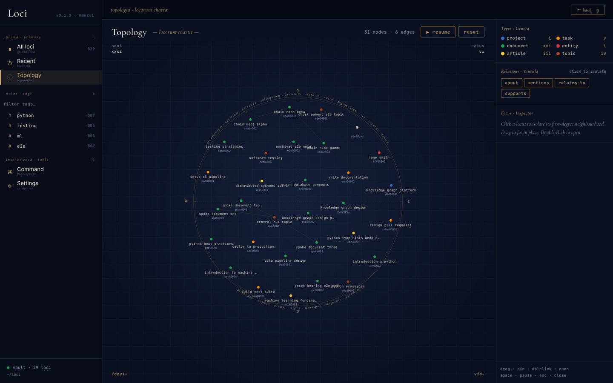

<div align="center">

<picture>
  <source media="(prefers-color-scheme: dark)" srcset="https://raw.githubusercontent.com/gked/loci/main/docs/images/monogram-dark.svg">
  
</picture>

<br/>
<br/>
<br/>

[](https://github.com/gked/loci/actions/workflows/test.yml)


[](https://github.com/gked/loci/blob/main/README.md) 

<br/>

</div>

# Loci

**Личный граф знаний, который принадлежит вам.** Loci хранит заметки, статьи,
книги, задачи, людей и разговоры как обычные Markdown-файлы в выбранной вами
папке. ИИ-агент читает и пишет эти файлы через MCP-сервер, а локальный
веб-интерфейс показывает их как граф.

**Проблема.** Знания разбросаны по десяткам приложений, и приложения друг о
друге не знают. ИИ-ассистент держит свою память на серверах вендора и в его
формате. А поиск находит только ту заметку, которую вы и так помнили.

**Что делает Loci.**

- **Хранит всё в одном месте, в файлах.** Каждый элемент — один Markdown-файл
  с YAML frontmatter. Такие файлы можно открыть, прогнать по ним `grep` и
  закоммитить без всякого другого ПО. Удалите Loci — файлы останутся.
- **Связывает элементы типизированными связями.** У каждого элемента есть
  постоянный 8-символьный ID, тип (`article`, `task`, `entity`, …) и
  типизированные ссылки на другие элементы (`is-based-on`, `contradicts`,
  `supersedes`, …). Ссылки держатся на ID, поэтому переименование их не рвёт.
- **Словарь задаёте вы, а не агент.** Типы, поля и связи описаны в
  версионируемых реестрах. Неизвестный тип или связь Loci при записи отклонит.
  Перед записью агент читает реестры.
- **Ссылается на файлы, а не перетаскивает их к себе.** Элемент может хранить
  место, где лежит файл: у вас на диске, в Google Drive, по URL, в Gmail и так
  далее.
- **Помнит каждое изменение.** Loci ведёт историю всех записей — в том числе
  правок, которые вы сделали руками.

**Для кого.** Вы каждый день работаете с ИИ-агентом (Claude Code поддерживается
полностью). Вам нужно одно место для всего, что вы читаете, пишете и решаете,
причём в формате, которым не владеет ни одна платформа.

Спрашивайте то, на что папка ответить не умеет: *что я знаю о стоицизме?* — и
получайте книги, журналы чтения, заметки, людей и связи между ними.



**Статус.** Личный проект в работе. Ядром автор пользуется каждый день, но
отдельные части ещё не доделаны.
[Статус и дорожная карта](https://github.com/gked/loci/blob/main/docs/ru-RU/roadmap.md)
показывают, какие именно.

---

## Быстрый старт

**Что нужно:** Python 3.13+ и [uv](https://docs.astral.sh/uv/) на одной из
поддерживаемых систем ниже.

| Платформа | Статус | Примечания |
|---|---|---|
| **macOS** (Apple Silicon) | **Поддерживается** | Основная платформа автора: macOS 26. Mac на Intel и более старые версии macOS не проверялись. |
| **Windows 11 Pro 24H2** (сборка 26100), ARM64, с **x64 Python** | **Поддерживается** | Установка: `uv tool install --python cpython-3.13-windows-x86_64 loci-vault`. Проверено в виртуальной машине: полный набор юнит-тестов прошёл (1 877 тестов, 49 пропущены намеренно), браузерный набор прошёл 82 из 83 (единственный сбой оказался плавающим из-за нагрузки и прошёл в 8 перезапусках из 8), а Claude Code, Claude Desktop и Hermes сохранили заметку и нашли её снова. Python для нативного ARM64 в Windows пока не ставится: у `cryptography` нет колёс для ARM64 Windows. CI для Windows нет, поэтому это проверенная конфигурация, а не гарантия для любого компьютера с Windows. |
| Другие Windows (Windows 11 на x64, Windows 10, редакции Home и Server) | Не проверялись | Ничего не утверждаем. |
| Linux | Не поддерживается | В CI на нём идут юнит- и браузерные тесты. Ручная установка опубликованного пакета на Ubuntu (arm64) тоже сработала. |

Агенты (Claude Code, Claude Desktop, Hermes) описаны по платформам в
[руководстве по установке](https://github.com/gked/loci/blob/main/docs/ru-RU/setup.md).

**1. Установите из PyPI**

```bash
uv tool install loci-vault
```

> **Пакет на PyPI называется `loci-vault`, а не `loci`.** Имя `loci` там занято
> посторонним проектом. Не запускайте `uv tool install loci` или
> `pip install loci`. Вы ставите `loci-vault`; команды, которые появляются
> вместе с ним, — `loci` и `loci-mcp`.

**2. Подключите к агенту**

```bash
loci setup
```

Одна команда ставит навыки и регистрирует MCP-сервер. Если Loci находит одного
агента (Claude Code или Hermes), он берёт его. Если нескольких — спрашивает,
какого. Чтобы не отвечать, добавьте `--target claude`, `--target hermes` или
`--target all`. Запускать повторно безопасно.

Хотите по отдельности? Навыки ставит `loci skills`, сервер регистрирует
`loci register`; `loci setup` — это обе команды и один вопрос.
Про других агентов см. [Поддержка агентов](#поддержка-агентов).

**3. Выберите папку хранилища**

Перезапустите Claude Code и скажите ему, где должно лежать хранилище:

```
Point Loci at ~/loci/vault
```

Пусть папка хранилища лежит внутри отдельной папки — как в примере. Рядом с хранилищем Loci
создаст ещё две папки: `assets/` (файлы, которые вы добавляете) и `loci-stage/`
(входящие для пакетного импорта). Для `~/loci/vault` все три окажутся в
`~/loci/`. Для `~/vault` они появятся прямо в вашей домашней папке.

**4. Пользуйтесь**

```
Save this article to my loci vault: https://example.com/post
What does my loci vault know about stoicism?
```

Чтобы посмотреть хранилище глазами, запустите веб-интерфейс:

```bash
loci        # opens on http://127.0.0.1:8765
```

| Команда | Что это |
|---|---|
| `loci` | Веб-интерфейс и его HTTP-бэкенд. Адрес меняется через `--host` / `--port` (или `LOCI_UI_HOST` / `LOCI_UI_PORT`). Если шаг 3 не выполнен, команда завершится ошибкой. |
| `loci-mcp` | MCP-сервер по stdio. Его запускает агент. Сами не запускайте. |

Об обновлениях, установке из репозитория и синхронизации см.
[docs/ru-RU/setup.md](https://github.com/gked/loci/blob/main/docs/ru-RU/setup.md).

---

## Поддержка агентов

Loci — обычный MCP-сервер, поэтому им может пользоваться любой агент с
поддержкой MCP.

| Агент | Статус |
|---|---|
| Claude Code | Поддерживается полностью, протестирован. Шаги выше ставят всё необходимое. |
| Claude Desktop (macOS, Windows) | Поддерживается. Регистрируется командой `loci register` (или установкой из репозитория, `uv run setup.py`). |
| Hermes | Поддерживается. `loci register --target hermes` и `loci skills --target hermes`. |
| DeepSeek Harness и другие агенты | Не тестировались. Настройка вручную — или попросите агента настроить себя сам. [Шаги](https://github.com/gked/loci/blob/main/docs/ru-RU/setup.md#другие-агенты-deepseek-harness-и-прочие). |
| Codex и другие MCP-клиенты | Должны работать. Не тестировались. Выполните шаги ниже. |

Если ваш агент — не Claude Code:

1. Зарегистрируйте в нём MCP-сервер. Для Codex:
   `codex mcp add loci -- loci-mcp`. Для остальных агентов смотрите их
   документацию по MCP. Запускается всё командой `loci-mcp`.
2. Если агент поддерживает навыки (папки `SKILL.md`), поставьте их в его папку
   навыков: `loci skills --dir <folder>`. У Codex это обычно
   `~/.codex/skills`.
3. Если навыков агент не поддерживает, добавьте в его инструкции такую строку:
   «Перед сохранением в Loci или чтением из него вызови инструмент `read_skill`
   MCP-сервера `loci` и следуй результату».

**Ваши данные и модель.** Хранилище остаётся на вашей машине. Когда агент
читает заметку, чтобы ответить вам, он отправляет её провайдеру модели — как и
любой другой файл, который читает.

---

## Документация

**Работа с Loci**

| | |
|---|---|
| [Проблема](https://github.com/gked/loci/blob/main/docs/ru-RU/problem.md) | Зачем нужен Loci и почему одной папки с Markdown или PKM-приложения не хватает |
| [Установка и настройка](https://github.com/gked/loci/blob/main/docs/ru-RU/setup.md) | Установка из PyPI, из релизного wheel или из репозитория. Обновление. Синхронизация и резервные копии |
| [Примеры](https://github.com/gked/loci/blob/main/docs/ru-RU/examples.md) | По одному запросу на каждую задачу: сохранить, найти, обновить, расширить онтологию |
| [Работа с Loci](https://github.com/gked/loci/blob/main/docs/ru-RU/usage.md) | Как о нём думать, сохранение, запросы, веб-интерфейс и устройство хранилища |
| [Онтология](https://github.com/gked/loci/blob/main/docs/ru-RU/ontology.md) | Типы, связи, схемы и версионирование реестров |
| [Статус и дорожная карта](https://github.com/gked/loci/blob/main/docs/ru-RU/roadmap.md) | Что стабильно, что сделано частично, что дальше |

**Разработка Loci**

| | |
|---|---|
| [CONTRIBUTING](https://github.com/gked/loci/blob/main/CONTRIBUTING.md) | Лицензия, CLA и правила для pull request |
| [Разработка](https://github.com/gked/loci/blob/main/docs/development.md) | Устройство репозитория, повседневные команды, релизы |
| [Тестирование](https://github.com/gked/loci/blob/main/docs/testing.md) | Модульные тесты и браузерные e2e-тесты |

**Справочник**

| | |
|---|---|
| [Сохранение файлов](https://github.com/gked/loci/blob/main/docs/file-saving.md) | Как файл на диске становится узлом хранилища |
| [Потоки выполнения](https://github.com/gked/loci/blob/main/docs/execution-flows.md) | Что делает каждый путь установки и обновления, шаг за шагом |
| [Диаграммы](https://github.com/gked/loci/blob/main/docs/diagrams.md) | Компоненты и поток данных |

---

## Лицензия

[PolyForm Noncommercial 1.0.0](https://github.com/gked/loci/blob/main/LICENSE).
Некоммерческое использование бесплатно: личное, исследовательское,
преподавательское и благотворительное, включая изменения и распространение.
**Для коммерческого использования нужна отдельная лицензия.** Чтобы её
получить, создайте issue.

Loci распространяется как source-available, а не open source. Лицензия
распространяется на это ПО, а не на заметки, которые вы в нём пишете. Хранилище
принадлежит вам.

## Участие в проекте

Прочитайте [CONTRIBUTING.md](https://github.com/gked/loci/blob/main/CONTRIBUTING.md).
Каждый pull request требует подписанного
[Контрибьюторского лицензионного соглашения](https://github.com/gked/loci/blob/main/CLA.md).
Подписывают его один раз, а авторские права остаются вашими.

---

## Об имени

***Loci*** /ˈloʊsaɪ/ (ЛОУ-сай, а римлянин сказал бы ЛОУ-ки) — латинское
«места», множественное число от *locus*. Название пришло из метода локусов,
классической мнемотехники. Всё, что нужно запомнить, вы кладёте в хорошо
знакомое место — комнату, дорогу. Чтобы вспомнить, вы мысленно проходите этот
путь заново. Loci даёт вашей цифровой жизни такое же пространство: у каждого
элемента есть своё постоянное место, и вы находите его по связям и по пути.
