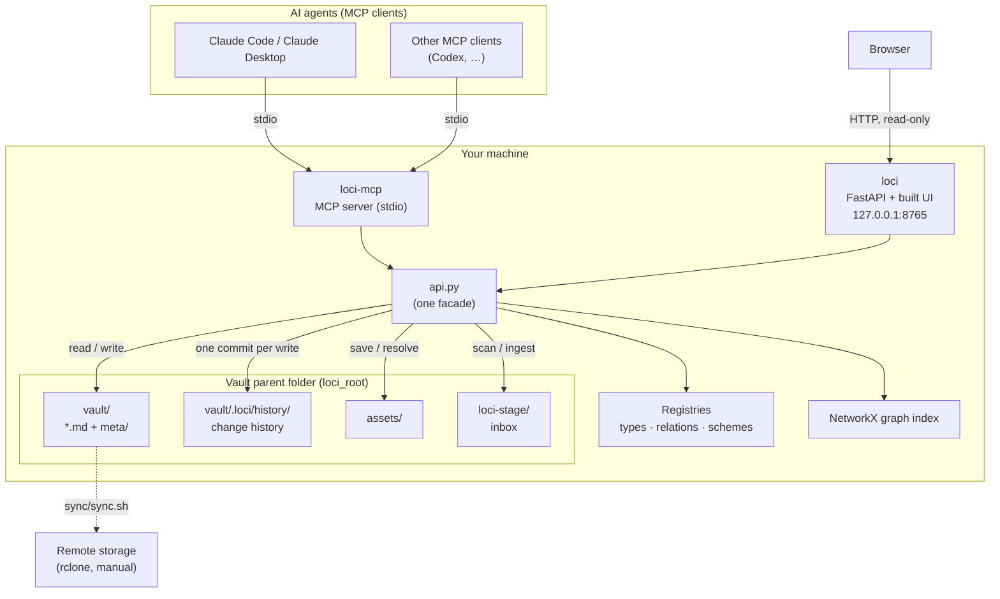
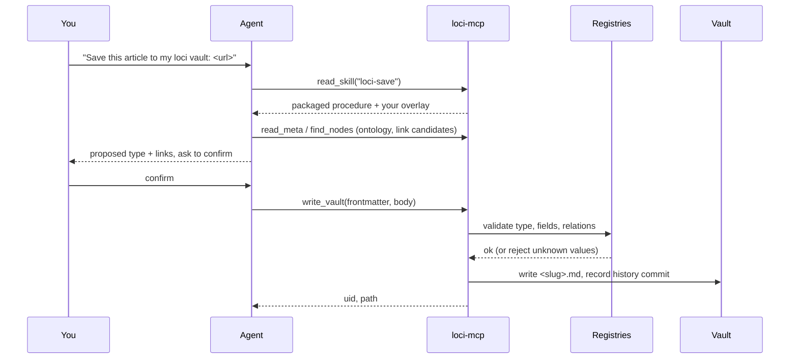

# Loci Architecture Diagrams

---

## 1. Components

One vault, two processes. The MCP server and the web UI are separate processes
over the same `api.py` facade, so they cannot drift onto different code paths.

## 2. A save, end to end

