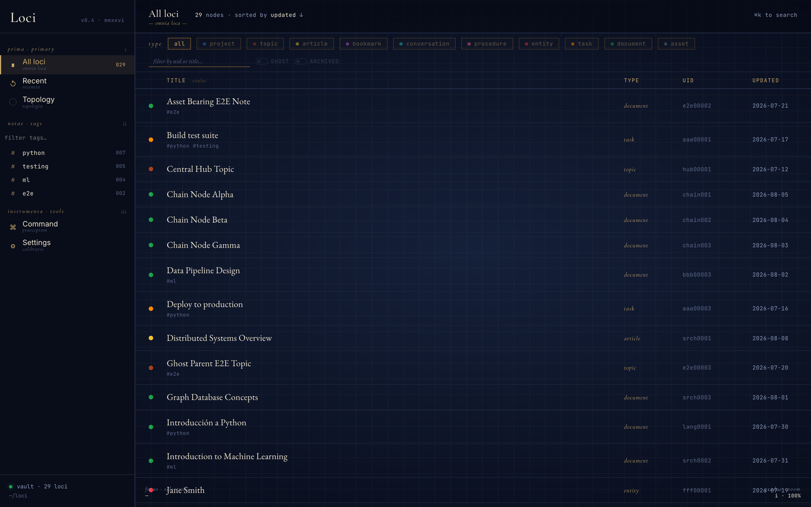
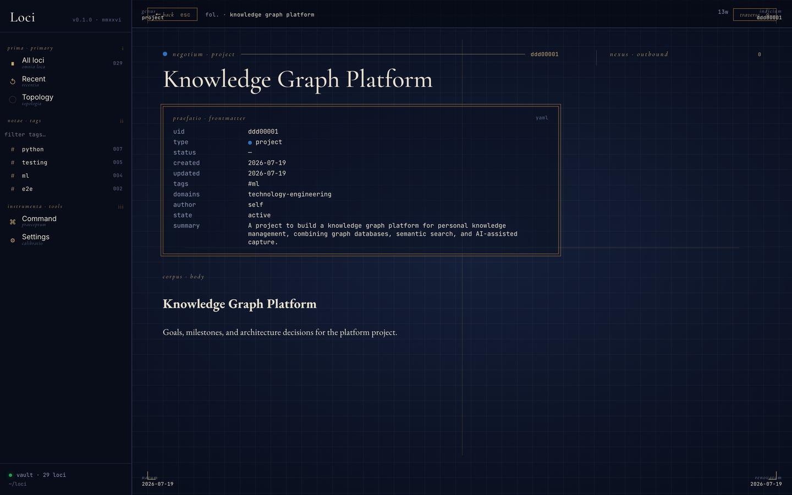
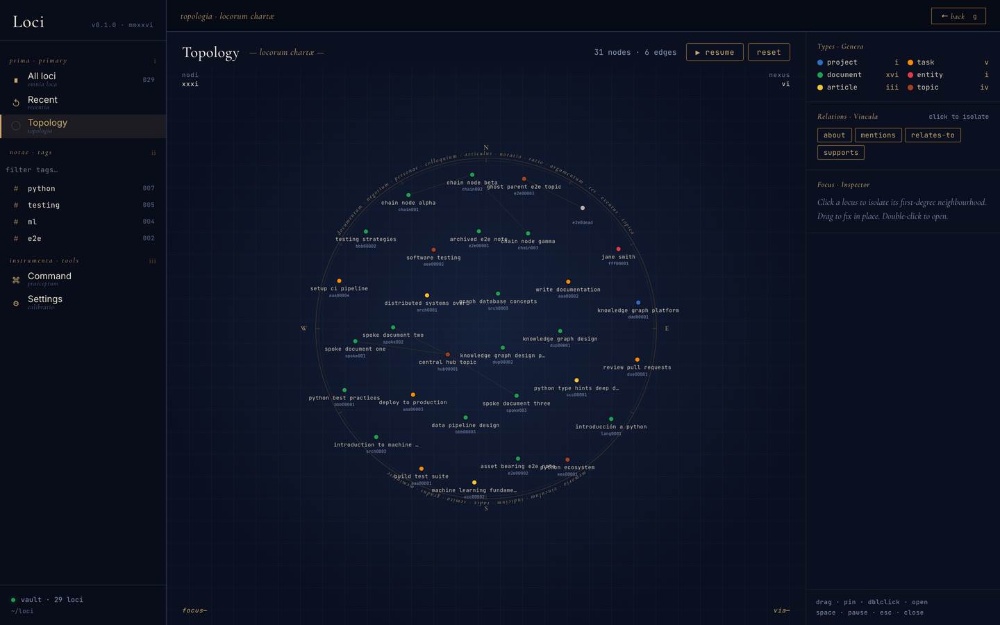
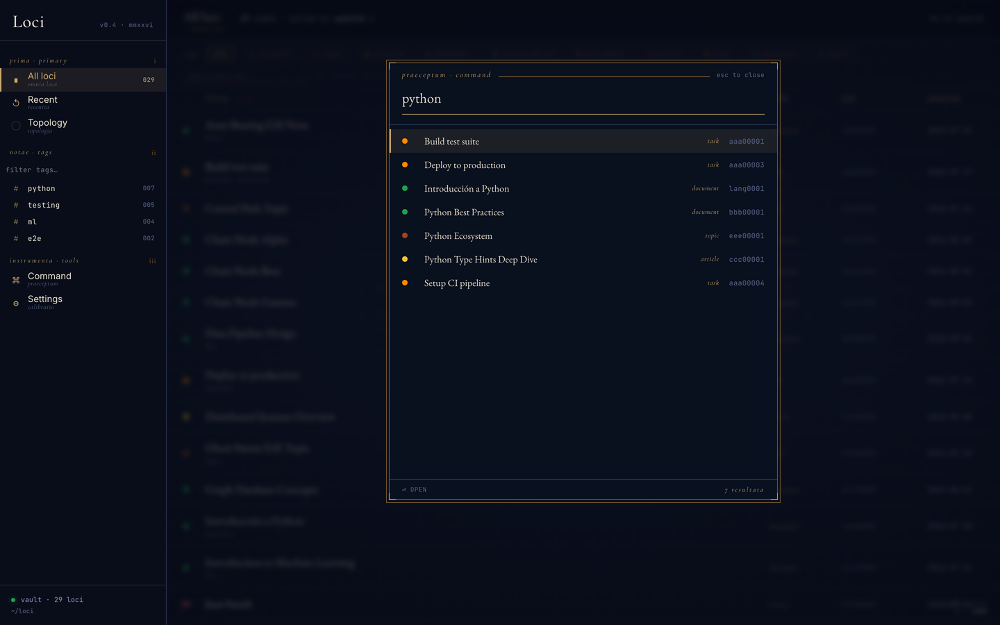

# Работа с Loci

## Как об этом думать

Loci — это память, а не картотека. Единица здесь — **узел**: один Markdown-файл
со стабильным UID, типом и типизированными рёбрами к другим узлам, и ценность
заключена в рёбрах. Заметка без связей — просто хранение; заметка, которая
`is-based-on` книгу, `mentions` человека и `belongs-to` проекту, — это то,
к чему можно вернуться с любой из этих сторон, подобно тому как метод локусов
обходит комнату.

Отсюда четыре привычки:

1. **Фиксируйте в момент, а не потом.** Рёбра проще всего записать, пока связь
   ещё свежа в голове. Навык `loci-save` при каждом сохранении предлагает связи
   и просит вас их подтвердить, так что уборка, до которой у вас никогда
   не дошли бы руки, происходит в момент записи.
2. **Пусть сортирует тип.** Каждый узел относится к одному из небольшого набора
   типов (`document`, `article`, `task`, `asset`, `entity`, `log`, `topic`, …)
   с полями, объявленными в реестре. Выберите тип — и поля, папка и то, как
   узел показывает интерфейс, определятся сами. Теги нужны для сквозных меток,
   а не для того, чем вещь *является* — см. [ontology.md](ontology.md).
3. **Указывайте на вещи, а не перемещайте их.** Узел может хранить местоположение —
   путь, диск, URL, почтовый ящик, — так что PDF остаётся где был, а хранилище
   записывает, что он существует и с чем связан. Копирование всего в одну папку —
   старый способ потерпеть неудачу, а не цель.
4. **Задавайте вопросы, а не ищите.** «Что я знаю о стоицизме?» должно возвращать
   книги, дневники чтения, заметки, людей и пути между ними. Навык `loci-query`
   обходит граф; поиск по строке — запасной вариант, а не главный вход.

## Сценарии

Одно и то же хранилище глазами тех ситуаций, для которых оно задумано:

| Вы… | Что вы делаете | Что делает Loci |
|---|---|---|
| Читаете что-то, что стоит сохранить | «Добавь эту статью в loci: <url>» | Получает метаданные, классифицирует, предлагает связи с тем, что у вас уже есть, записывает узел `article` |
| Вам в голову пришла мысль посреди работы | «Сохрани это в моё хранилище loci как заметку: …» | Записывает узел `document`, связывает его с проектом или темой, в которой вы находились |
| Начинаете или заканчиваете книгу | «Запиши чтение в loci: …» | Книга — это `asset`; каждое чтение — отдельный узел `log`, так что повторные прочтения и изменившиеся мнения остаются раздельными |
| Сидите на горе файлов | Положите их в `loci-stage/`, «Обработай мой входящий ящик loci» | Планирует пакет, просит одобрения, загружает возобновляемыми запусками |
| Владеете папкой, которую не хотите трогать | «Загрузи ~/Documents/papers в моё хранилище loci» | Создаёт узлы, указывающие на файлы на месте; ничего не копируется |
| Пытаетесь вспомнить | «Что моё хранилище loci знает о X?» | Обходит граф и отвечает узлами и путями между ними |
| Передумываете | Сохраните новую позицию и скажите, что она заменяет прежнюю | Обе сохраняются; ребро `supersedes` фиксирует, в какую сторону вы сдвинулись |
| Просматриваете, а не спрашиваете | Запустите веб-интерфейс (`loci`) | Фильтр по типу и тегу, чтение узлов, обход топологии, `⌘K` для быстрого перехода |

Остальная часть страницы описывает механику каждого сценария; [examples.md](examples.md) — по одному промпту на сценарий.

---

## Научите агента один раз

Claude выбирает навык по формулировке запроса, а голое «сохрани это»
достаточно двусмысленно, чтобы попасть во временный файл, в другой инструмент
для заметок или вообще никуда. Можно каждый раз говорить «loci» или «моё хранилище»
либо один раз объяснить, что для вас значат эти слова. В Claude Code добавьте
строку в `~/.claude/CLAUDE.md` (или введите её в сессии с ведущим `#`, что делает то же самое):

```
Когда я говорю «сохрани это», «запомни это», «запиши это», «зафиксируй это» или «залогируй
это», используй навык loci-save и пиши в моё хранилище Loci — не спрашивай, какой
инструмент я имею в виду. Когда я спрашиваю, что я знаю о чём-то, что с этим связано
или что я недавно сохранял, используй навык loci-query. При каждом сохранении предлагай связи
с существующими узлами и подтверждай перед записью.
```

В Claude Desktop или claude.ai тот же абзац помещается в инструкции проекта
или в ваши пользовательские инструкции. После этого промпты из
[examples.md](examples.md) работают как написано, без упоминания хранилища.

---

## Сохранение

Опишите, что хотите сохранить, и **скажите «loci» или «моё хранилище» в запросе**:

```
Сохрани это в моё хранилище loci как заметку: ...
Добавь эту статью в loci: https://example.com/article
Создай задачу в моём хранилище: Проверить архитектуру Loci к пятнице
Сохрани эту сущность в loci: John Smith, CEO в Acme Corp
```

Упоминание хранилища направляет запрос в навык `loci-save`, который читает
онтологию, определяет тип, формирует frontmatter, предлагает связи с сущностями
и записывает файл. [Научите агента один раз](#научите-агента-один-раз) — и «loci»
можно не произносить.

### Запросы

То же правило и при чтении:

```
Что моё хранилище loci знает о стоицизме?
Что связано с проектом Loci в моём хранилище?
Что я сохранил в loci за последние две недели?
Как связаны эти две заметки в хранилище?
```

Навык `loci-query` использует инструменты графа (`query_neighbors`, `query_related`, `query_path`, `find_nodes`, `search_vault`, `query_recent`, `query_insights`), а не grep по файлам.

### Библиотека

Ведите свою библиотеку электронных книг как граф знаний. Книги сохраняются как узлы `asset` с `subtype: book`; каждый раз, когда вы читаете книгу, узел `log` (с тегом `reading`) фиксирует ваши заметки, выделения и оценку — отдельно для каждого прочтения, так что повторные прочтения учитываются независимо.

```
Сохрани эту электронную книгу в мою библиотеку loci: Thinking, Fast and Slow by Kahneman
Запиши чтение в loci: дочитал «Имя розы», 5/5, начал 1 марта
Что моё хранилище знает о стоицизме? (находит книги, дневники чтения и связанные темы)
```

### Входящие

Положите файлы в `loci-stage/` и запустите навык inbox, чтобы обработать их пакетами:

```
Обработай мой входящий ящик loci
```

Агент сканирует промежуточную папку, представляет план с оценкой стоимости и времени, ждёт вашего одобрения, затем загружает файлы пакетами настраиваемого размера (по умолчанию: 50 электронных книг за запуск, 10 текстовых элементов за запуск; настраивается через `DEFAULT_BUDGET_FILES` / `DEFAULT_BUDGET_CONTENT` в `src/loci/tools/inbox_plan.py`). Прогресс сохраняется в `.inbox-plan.yaml`, так что сессию можно прервать и возобновить.

### Загрузка каталога на месте

```
Загрузи ~/Documents/papers в моё хранилище loci
```

`scan_directory` каталогизирует файлы там, где они уже лежат, а навык `loci-ingest-directory` создаёт узлы, у которых расположения `has_asset` указывают на исходные пути. Ничего не копируется и не перемещается.

---

## Настройка навыков

У каждого навыка две половины. Встроенная процедура поставляется внутри Loci и
заменяется при каждом обновлении. Ваши дополнения живут в хранилище —
`<vault>/skills/loci-save.md`, `loci-query.md`, `loci-inbox.md`,
`loci-ingest-directory.md` — создаются один раз и никогда не перезаписываются. Каждый
раз, когда навык запускается, MCP-сервер передаёт Claude процедуру с вашим файлом
в конце, под преамбулой, объясняющей, как они сочетаются: **ваши дополнения побеждают
везде, где расходятся с процедурой, кроме разделов под заголовками с пометкой 🔒**,
которые действуют, что бы вы ни написали. (Заблокированные разделы — это ограждения
безопасности: сначала проверить хранилище, спросить перед записью, никогда не гадать о намерении.)

Добавляйте правило так, как сказали бы коллеге:

```
Отныне при сохранении протоколов встреч всегда ставь тег #meeting-notes и
связывай каждого участника, у которого есть узел entity.
```

Claude записывает это в дополнения через `write_skill`, и правило действует уже
при следующем сохранении — ничего переустанавливать и перезапускать не нужно. Правила, которые
заслужили там место, выглядят так:

```
- Закладки с arxiv.org — это статьи, а не закладки: забирай аннотацию.
- Это хранилище только для работы: по умолчанию `domains: [work]`, если я не скажу иначе.
- Когда я спрашиваю о человеке, включай его самые свежие записи log.
- Всё в `loci-stage/receipts/` — это `document` с тегом #receipt; не спрашивай.
```

Файл — обычный Markdown, поэтому его можно править и вручную. Делайте каждое правило
коротким и конкретным: модель следует им буквально, а абзац
контекста — это абзац, который ей приходится держать в голове при каждом запуске. Чтобы увидеть, что
действует сейчас, попросите Claude прочитать навык — дополнения идут последним
разделом того, что возвращает `read_skill`.

Что куда:

| Вы хотите… | Положить в |
|---|---|
| Изменить поведение навыка для себя | дополнения навыка в `<vault>/skills/` |
| Добавить тип, связь или схему | `ontology-user.yaml` и соседние файлы — см. ниже |
| Объяснить Claude, какие слова значат «используй Loci» | `~/.claude/CLAUDE.md` — см. [выше](#научите-агента-один-раз) |

## Расширение онтологии

Словарь состоит из двух слоёв, и именно это разделение позволяет обновлять Loci,
не затрагивая вашу работу:

| Слой | Файлы в `<vault>/meta/` | Кто пишет | При обновлении |
|---|---|---|---|
| **Канонический** | `ontology.yaml`, `relation-dictionary.yaml`, `scheme-dictionary.yaml` | Loci | Пересоздаётся при каждом изменении `META_VERSION` — правки перезаписываются |
| **Ваш** | `ontology-user.yaml`, `relation-dictionary-user.yaml`, `scheme-dictionary-user.yaml`, `tag-dictionary.md` | Вы или Claude от вашего имени | Создаётся один раз, никогда не перезаписывается |

При запуске реестры загружают канонический файл, затем накладывают сверху
пользовательский. Получается один словарь: определённый вами тип проверяется при записи,
проверяется `lint_vault` и предлагается Claude точно так же, как поставляемый.

### Определение типа

Попросите обычными словами:

```
Определи в моём хранилище loci тип `recipe`, расширяющий `procedure`, с
необязательными полями `servings` и `cuisine`.
```

Claude вызывает `validate_type`, затем `define_type`, который добавляет запись в
`ontology-user.yaml` и перезагружает реестр — тип доступен в той же
сессии, без перезапуска. YAML можно править и вручную; изменения подхватятся
при следующем запуске сервера.

Три правила ограничивают пользовательский тип, и `define_type` отклоняет всё
за их пределами:

1. **Он расширяет канонический тип.** `extends` должен указывать на один из поставляемых
   типов, а не на другой пользовательский, так что иерархия остаётся ровно
   одноуровневой и каждая заметка по-прежнему узнаваемо относится к одному из базовых видов.
2. **Имя новое.** Без совпадения с каноническим типом или существующим
   пользовательским.
3. **Только добавление.** Можно добавлять поля и значения enum; нельзя переопределять
   или удалять унаследованное.

Новый тип наследует все поля родителя и добавляет ваши сверху.
`recipe` по-прежнему требует `steps`, потому что их требует `procedure`.

### Определение связи или схемы

Та же форма, меньше правил: имя не должно совпадать с существующим, и всё.

```
Определи в моём хранилище loci связь `cooked-from`, обратную к `is-based-on`,
для записи log о приготовлении по рецепту.
```

`define_relation` добавляет запись в `relation-dictionary-user.yaml`; `inverse_of`
может указывать на каноническую связь. Схемы (где лежит файл) попадают в
`scheme-dictionary-user.yaml`.

### Как взаимодействуют два слоя

- **Проверка выполняется за один проход.** При записи неизвестный тип или связь
  отклоняется независимо от того, был ли нужный словарь каноническим или вашим; известный
  пользовательский тип проходит так же, как поставляемый.
- **Обновления не трогают ваш файл, но могут сдвинуться под ним.** Если в более позднем
  релизе появится канонический тип или связь с тем же именем, что у вашего,
  ваш будет пропущен при загрузке (канонический побеждает), а использующие его заметки начнут
  не проходить проверку как неизвестные. Заметки к релизам помечают повышения `META_VERSION`
  именно по этой причине; после такого запустите `lint_vault`.
- **Неверные записи пропускаются, а не приводят к ошибке.** Вручную отредактированная запись, нарушающая
  правило (расширяет пользовательский тип, переопределяет унаследованное поле), отбрасывается при
  загрузке реестра, и сервер продолжает работу. Никаких уведомлений нет; симптом —
  `lint_vault`, сообщающий о заметках с неизвестным типом. Чтобы избежать молчаливого случая,
  используйте `define_type` вместо ручной правки.
- **Веб-интерфейс знает только канонические типы.** Его панель фильтров по типу и
  карта цветов — фиксированный список, поэтому заметка пользовательского типа отображается и
  читается, но не имеет ни чипа фильтра, ни собственного цвета. У MCP-стороны такого
  пробела нет.
- **Теги — дешёвый слой.** Прежде чем определять тип, спросите себя, не хватит ли
  тега на существующем типе. Тип оправдан, когда нужно структурированное,
  доступное для запросов поле (`servings`); если вы хотите лишь *находить* свои рецепты,
  лучше `#recipe` на `procedure`. Словарь тегов хранится в `tag-dictionary.md` — он тоже ваш.

Полный справочник — каждый канонический тип, связь и схема и когда применяется каждое
правило — это [руководство по онтологии](../../src/loci/skills/references/ontology-guide.md),
которое попадает в ваше хранилище как `meta/ontology-guide.md`. Взгляд на
реестры со стороны репозитория — [ontology.md](ontology.md).

---

## Веб-интерфейс хранилища

Локальное React-приложение для просмотра графа. Обе половины запускаются одной командой:

```bash
make run          # ваше настоящее хранилище: API на :8765 + собранный интерфейс на :4173
make dev          # временное dev-хранилище:  API на :8765 + dev-сервер Vite на :5173
```

`make run` читает `~/.config/loci/config.yml` — то же хранилище, которое
обслуживает MCP-сервер. `make dev` намеренно этого не делает; см. [development.md](../development.md#running).

Бэкенд — `src/loci/http_server.py`, тонкий слой FastAPI над тем же фасадом `src/loci/api.py`, которым пользуется MCP-сервер, поэтому интерфейс не может уйти на отдельный путь выполнения. Сегодня он только для чтения (API допускает лишь `GET`); запись идёт через Claude.

### Индекс хранилища

Всё содержимое хранилища, с фильтром по типу вверху и по тегу на левой панели. В каждой строке — точка типа, теги, uid и дата последнего обновления.



### Просмотр узла

Frontmatter отображается подписанной сеткой, а не сырым YAML, а под ним — Markdown-текст. Узлы с ассетом также показывают его разрешённое расположение и, для небольших текстовых файлов, встроенное содержимое.



### Топология

Граф в виде силовой карты, раскрашенной по типу и фильтруемой по связи. Щёлкните узел, чтобы выделить его ближайшее окружение, перетащите, чтобы закрепить, дважды щёлкните, чтобы открыть. Пробел приостанавливает симуляцию.



### Палитра команд

`⌘K` из любого места. Ищет по заголовкам и описаниям, показывая тип и uid для каждого результата.



> Снимки сделаны на фикстурном хранилище e2e, а не на настоящем. `make screenshots` создаёт их заново.

---

## Структура хранилища

Хранилище **плоское**: каждый узел — это Markdown-файл в корне хранилища, названный по слагу заголовка (`why-i-left-twitter.md`). Папок по типам нет; тип — это frontmatter, а упорядочивает граф-индекс. Единственная видимая подпапка — `meta/`; скрытая папка `.loci/` хранит историю изменений.

```
~/loci/                              ← корень loci (все хранилища — соседние каталоги)
  knowledge-vault/                   ← граф знаний, только markdown
    <slug>.md                        ← один файл на узел, плоско
    meta/
      ontology.yaml                  ← машиночитаемая система типов     (пересоздаётся при повышении META_VERSION)
      ontology-user.yaml             ← пользовательские расширения типов (принадлежит пользователю)
      relation-dictionary.yaml       ← машиночитаемые связи             (пересоздаётся)
      relation-dictionary-user.yaml  ← пользовательские связи           (принадлежит пользователю)
      scheme-dictionary.yaml         ← словарь схем расположения        (пересоздаётся)
      scheme-dictionary-user.yaml    ← пользовательские схемы           (принадлежит пользователю)
      type-dictionary.md             ← словарь типов для человека       (пересоздаётся)
      field-dictionary.md            ← определения полей по типам       (пересоздаётся)
      tag-dictionary.md              ← свободный словарь тегов          (принадлежит пользователю)
      relation-dictionary.md         ← руководство по связям для человека (пересоздаётся)
      foreign-definitions.md         ← схемы внешних источников         (принадлежит пользователю)
      .meta-version                  ← на какой META_VERSION создано это хранилище
    .loci/history/                   ← история изменений: репозиторий в формате Git, которым владеет Loci

  assets/                       ← бинарные/насыщенные файлы, принятые в хранилище
    <uid>.<ext>                 ← один файл на ассет, имя — UID узла хранилища
    .pending/                   ← файлы намерений для восстановления после сбоя при записи

  loci-stage/                   ← промежуточный входящий ящик, кладите сюда файлы для пакетной загрузки
    .inbox-plan.yaml            ← очередь работ, записанная scan_inbox и обрабатываемая при выполнении
```

`assets/` и `loci-stage/` — **соседние** с хранилищем каталоги, а не внутри него. Loci создаёт их в родительской папке хранилища — какой бы она ни была. Поэтому выбирайте путь хранилища на один уровень внутри отдельной папки (`~/loci/vault`, а не `~/vault`). Каталог хранилища содержит только файлы `.md`. Полную последовательность записи см. в [docs/file-saving.md](../file-saving.md).

### Ассеты и расположения

Узел указывает на свои исходные файлы через список `has_asset` во frontmatter. Каждая запись — это формат с одним или несколькими кандидатами расположения:

```yaml
has_asset:
  - format: epub
    primary: true
    locations:
      - scheme: local
        path: assets/56bb363e.epub
      - scheme: google-drive
        file_id: 1AbCdEf…
```

`resolve_asset` проходит по расположениям по порядку и возвращает первое, которое разрешается. Схемы объявлены в `scheme-dictionary.yaml` и проверяются при записи; `local` и `url` получают содержимое напрямую, а облачные и удалённые схемы (`google-drive`, `nextcloud`, `gmail`, `onedrive`, `dropbox`, `icloud-drive`, `s3`, `ssh-remote`) разрешаются в указатель, который открывает соответствующий MCP или нативный инструмент. `find_nodes(has_asset_scheme=…)` фильтрует граф по схеме.

Это заменило отдельное хранилище YAML `asset-registry/` (рефакторинг расположений, фаза 5). Данные о расположении теперь живут во frontmatter самого узла.

### История хранилища

Каждая запись, сделанная Loci, фиксируется одним коммитом в `knowledge-vault/.loci/history/`. Loci сам читает и пишет этот репозиторий, так что Git устанавливать не нужно.

- **Правки, сделанные вне Loci** (вручную, в Obsidian, инструментом синхронизации), фиксируются одним коммитом «Changes made outside Loci», выполняемым перед следующей записью. Они никогда не сливаются с посторонним изменением. На очень большом хранилище (полная проверка занимает более 0,1 секунды) проверка выполняется не чаще раза в минуту, так что внешняя правка фиксируется при следующей проверке.
- **Ваш собственный `.git`**, если вы держите хранилище в репозитории, никогда не затрагивается. История его пропускает, а также пропускает мусор редакторов (`.DS_Store`, `*.swp`, `*~`) и папку настроек Obsidian `.obsidian/`.
- **Ассетов в ней нет.** Они лежат рядом с хранилищем; в истории только узлы, которые на них указывают.
- **Она путешествует вместе с хранилищем.** Переместите, скопируйте или синхронизируйте папку хранилища — и история отправится с ней.
- **Её можно читать через Git**, если он у вас есть: `git --git-dir knowledge-vault/.loci/history log`. Используйте `log`, `show` и `diff` между коммитами. У хранилища нет рабочего дерева, поэтому `git status` не имеет смысла.
- **Боковая панель показывает её состояние** (`historia · on`). Если история отключена или запись не удалось зафиксировать, панель окрашивает строку в оранжевый, и уведомление при запуске MCP сообщает об этом.
- **Отключить** можно через `LOCI_VAULT_HISTORY=0`.
