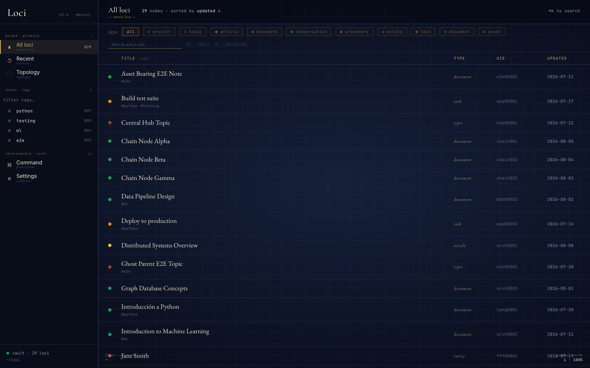
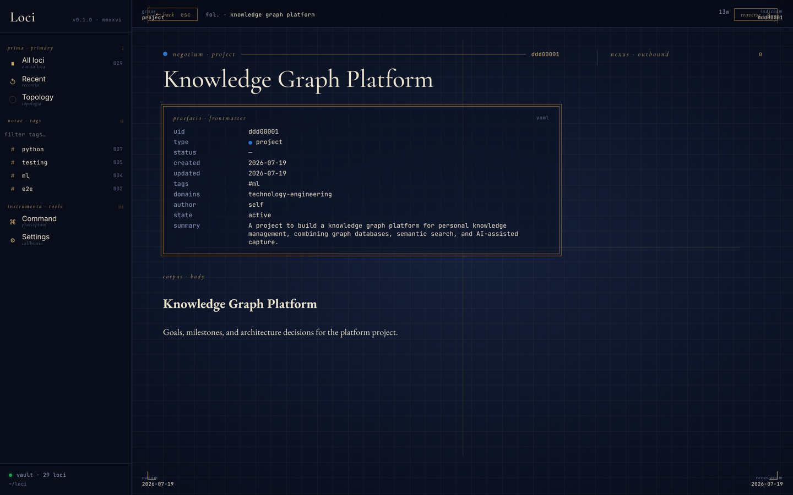
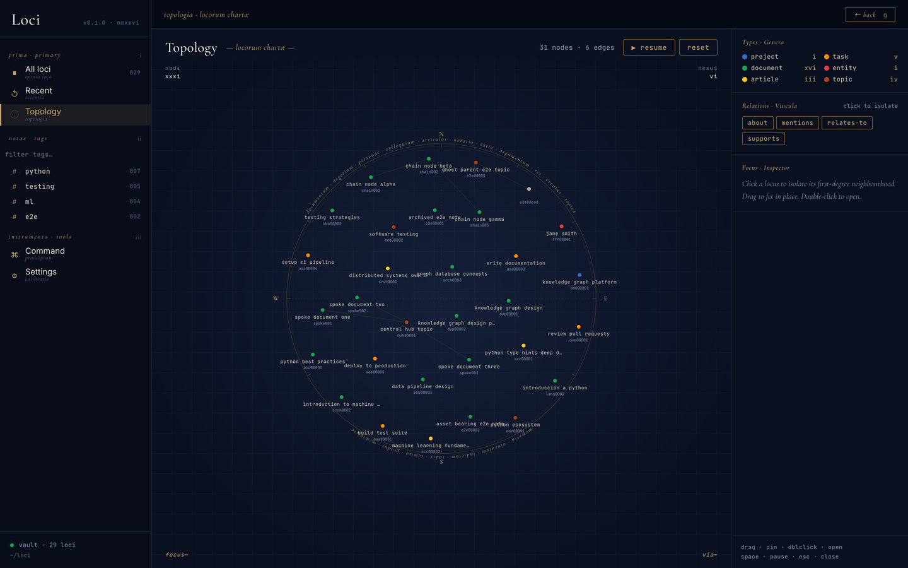
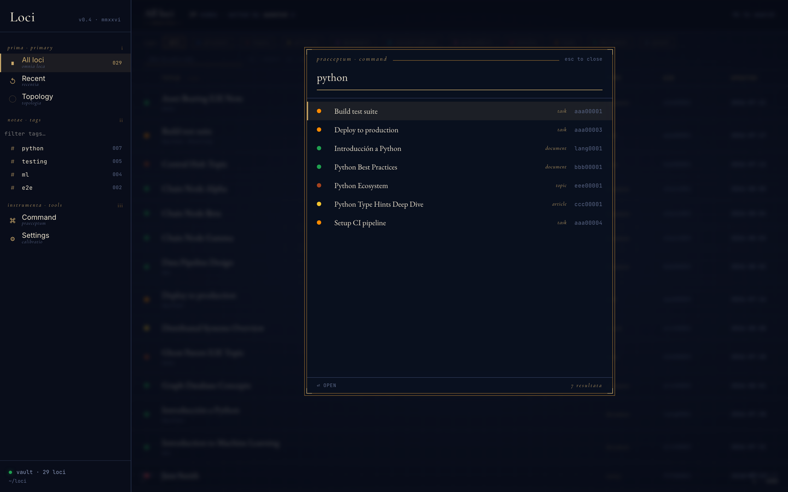

# Работа с Loci

## Как об этом думать

Loci — это память, а не картотека. Единица здесь — **узел**: один
Markdown-файл с постоянным UID, типом и типизированными рёбрами к другим
узлам. Ценность — в рёбрах. Заметка без связей — просто склад; заметка,
которая `is-based-on` книгу, `mentions` человека и `belongs-to` проект, — это
то, к чему можно вернуться с любой из этих сторон, как метод локусов обходит
комнату.

Отсюда четыре привычки:

1. **Записывайте в момент, а не потом.** Рёбра дешевле всего записать, пока
   связь ещё свежа в голове. Навык `loci-save` при каждом сохранении предлагает
   связи и просит их подтвердить — так уборка, до которой у вас так и не дошли
   бы руки, случается в момент записи.
2. **Пусть сортирует тип.** Каждый узел принадлежит одному из небольшого набора
   типов (`document`, `article`, `task`, `asset`, `entity`, `log`, `topic`, …)
   с полями, объявленными в реестре. Выберите тип — и поля, папка и то, как
   узел выглядит в интерфейсе, определятся сами. Теги нужны для сквозных
   пометок, а не для того, чем вещь *является*, — см. [ontology.md](ontology.md).
3. **Ссылайтесь на вещи, а не перетаскивайте их.** Узел может хранить
   местоположение — путь, диск, URL, почтовый ящик, — поэтому PDF остаётся где
   был, а хранилище записывает, что он существует и с чем связан. Свалить всё
   в одну папку — привычная ловушка, а не цель.
4. **Спрашивайте, а не ищите.** «Что я знаю о стоицизме?» должно возвращать
   книги, журналы чтения, заметки, людей и пути между ними. Навык `loci-query`
   обходит граф; поиск по строке — запасной вариант, а не главный вход.

## Сценарии

Одно и то же хранилище — в ситуациях, для которых оно задумано:

| Вы… | Что вы делаете | Что делает Loci |
|---|---|---|
| Читаете то, что стоит сохранить | «Добавь эту статью в loci: <url>» | Забирает метаданные, определяет тип, предлагает связи с тем, что у вас уже есть, записывает узел `article` |
| Думаете о чём-то посреди работы | «Сохрани это в моё хранилище loci как заметку: …» | Записывает узел `document`, связывает его с проектом или темой, в которой вы были |
| Берётесь за книгу или дочитываете её | «Запиши чтение в loci: …» | Книга — это `asset`; каждое прочтение — свой узел `log`, поэтому повторные прочтения и изменившиеся мнения остаются раздельными |
| Разгребаете гору файлов | Кладёте их в `loci-stage/`, «Обработай мой входящий ящик loci» | Строит план партиями, просит одобрения, загружает; прерванную загрузку можно продолжить |
| Владеете папкой, которую не хотите трогать | «Загрузи ~/Documents/papers в моё хранилище loci» | Создаёт узлы, которые указывают на файлы на месте; ничего не копируется |
| Пытаетесь вспомнить | «Что моё хранилище loci знает о X?» | Обходит граф и отвечает узлами и путями между ними |
| Передумываете | Сохраняете новую позицию и говорите, что она заменяет прежнюю | Обе остаются; ребро `supersedes` фиксирует, в какую сторону вы сдвинулись |
| Хотите посмотреть, а не спросить | Запускаете веб-интерфейс (`loci`) | Фильтр по типу и тегу, чтение узлов, обход топологии, `⌘K` для быстрого перехода |

Дальше на странице — механика каждого сценария; [examples.md](examples.md) — по одному запросу на сценарий.

---

## Научите агента один раз

Claude выбирает навык по формулировке запроса, а голое «сохрани это»
достаточно двусмысленно, чтобы попасть во временный файл, в другой инструмент
для заметок или вообще никуда. Можно каждый раз говорить «loci» или «моё
хранилище», а можно один раз объяснить, что для вас значат эти слова. В Claude
Code добавьте строку в `~/.claude/CLAUDE.md` (или введите её в сессии с ведущим
`#` — результат тот же):

```
Когда я говорю «сохрани это», «запомни это», «запиши это», «зафиксируй это» или «залогируй
это», используй навык loci-save и пиши в моё хранилище Loci — не спрашивай, какой
инструмент я имею в виду. Когда я спрашиваю, что я знаю о чём-то, что с этим связано
или что я недавно сохранял, используй навык loci-query. При каждом сохранении предлагай связи
с существующими узлами и подтверждай перед записью.
```

В Claude Desktop или claude.ai этот же абзац кладут в инструкции проекта или
в свои пользовательские инструкции. После этого запросы из
[examples.md](examples.md) работают как написаны, без упоминания хранилища.

---

## Сохранение

Опишите, что хотите сохранить, и **скажите в запросе «loci» или «моё хранилище»**:

```
Сохрани это в моё хранилище loci как заметку: ...
Добавь эту статью в loci: https://example.com/article
Создай задачу в моём хранилище: Проверить архитектуру Loci к пятнице
Сохрани эту сущность в loci: John Smith, CEO в Acme Corp
```

Упоминание хранилища направляет запрос в навык `loci-save`: он читает
онтологию, определяет тип, собирает frontmatter, предлагает связи с сущностями
и записывает файл. [Научите агента один раз](#научите-агента-один-раз) — и слово
«loci» можно не произносить.

### Запросы

При чтении действует то же правило:

```
Что моё хранилище loci знает о стоицизме?
Что связано с проектом Loci в моём хранилище?
Что я сохранил в loci за последние две недели?
Как связаны эти две заметки в хранилище?
```

Навык `loci-query` работает инструментами графа (`query_neighbors`, `query_related`, `query_path`, `find_nodes`, `search_vault`, `query_recent`, `query_insights`), а не grep по файлам.

### Библиотека

Ведите библиотеку электронных книг как граф знаний. Книги сохраняются как узлы `asset` с `subtype: book`; каждый раз, когда вы читаете книгу, узел `log` (с тегом `reading`) фиксирует ваши заметки, выделения и оценку — отдельно для каждого прочтения, так что повторные прочтения учитываются независимо.

```
Сохрани эту электронную книгу в мою библиотеку loci: Thinking, Fast and Slow by Kahneman
Запиши чтение в loci: дочитал «Имя розы», 5/5, начал 1 марта
Что моё хранилище знает о стоицизме? (находит книги, дневники чтения и связанные темы)
```

### Входящие

Положите файлы в `loci-stage/` и запустите навык inbox — он разберёт их партиями:

```
Обработай мой входящий ящик loci
```

Агент просматривает промежуточную папку, показывает план с оценкой затрат и времени, ждёт вашего одобрения, а затем загружает файлы партиями настраиваемого размера (по умолчанию: 50 электронных книг за запуск, 10 текстовых элементов за запуск; меняется через `DEFAULT_BUDGET_FILES` / `DEFAULT_BUDGET_CONTENT` в `src/loci/tools/inbox_plan.py`). Прогресс сохраняется в `.inbox-plan.yaml`, поэтому сессию можно прервать и потом продолжить.

### Загрузка каталога на месте

```
Загрузи ~/Documents/papers в моё хранилище loci
```

`scan_directory` описывает файлы там, где они уже лежат, а навык `loci-ingest-directory` создаёт узлы, у которых расположения `has_asset` указывают на исходные пути. Ничего не копируется и не переносится.

---

## Настройка навыков

У каждого навыка две половины. Встроенная процедура поставляется внутри Loci и
заменяется при каждом обновлении. Ваши дополнения живут в хранилище —
`<vault>/skills/loci-save.md`, `loci-query.md`, `loci-inbox.md`,
`loci-ingest-directory.md` — создаются один раз и никогда не перезаписываются.
Каждый раз, когда навык запускается, MCP-сервер отдаёт Claude процедуру, а в
конец добавляет ваш файл — под преамбулой о том, как они сочетаются: **ваши
дополнения главнее везде, где расходятся с процедурой, кроме разделов под
заголовками с пометкой 🔒**, которые действуют, что бы вы ни написали. (Разделы
с замком — это предохранители: сначала проверить хранилище, спросить перед
записью, не угадывать намерение.)

Добавляйте правило так, как сказали бы коллеге:

```
Отныне при сохранении протоколов встреч всегда ставь тег #meeting-notes и
связывай каждого участника, у которого есть узел entity.
```

Claude записывает это в дополнения через `write_skill`, и правило действует уже
при следующем сохранении — ничего не нужно переустанавливать и перезапускать.
Правила, которые там приживаются, выглядят так:

```
- Закладки с arxiv.org — это статьи, а не закладки: забирай аннотацию.
- Это хранилище только для работы: по умолчанию `domains: [work]`, если я не скажу иначе.
- Когда я спрашиваю о человеке, включай его самые свежие записи log.
- Всё в `loci-stage/receipts/` — это `document` с тегом #receipt; не спрашивай.
```

Файл — обычный Markdown, так что его можно править и руками. Держите каждое
правило коротким и конкретным: модель выполняет их буквально, а каждый абзац
контекста ей приходится держать в голове при каждом запуске. Чтобы увидеть, что
действует сейчас, попросите Claude прочитать навык — дополнения идут последним
разделом того, что возвращает `read_skill`.

Что куда:

| Вы хотите… | Положить в |
|---|---|
| Изменить поведение навыка для себя | дополнения навыка в `<vault>/skills/` |
| Добавить тип, связь или схему | `ontology-user.yaml` и соседние файлы — см. ниже |
| Объяснить Claude, какие слова значат «используй Loci» | `~/.claude/CLAUDE.md` — см. [выше](#научите-агента-один-раз) |

## Расширение онтологии

Словарь состоит из двух слоёв, и именно это разделение позволяет обновлять Loci,
не задевая вашу работу:

| Слой | Файлы в `<vault>/meta/` | Кто пишет | При обновлении |
|---|---|---|---|
| **Канонический** | `ontology.yaml`, `relation-dictionary.yaml`, `scheme-dictionary.yaml` | Loci | Пересоздаётся при каждом изменении `META_VERSION` — правки затираются |
| **Ваш** | `ontology-user.yaml`, `relation-dictionary-user.yaml`, `scheme-dictionary-user.yaml`, `tag-dictionary.md` | Вы или Claude от вашего имени | Создаётся один раз, никогда не перезаписывается |

При запуске реестры загружают канонический файл, а сверху накладывают
пользовательский. Получается один словарь: определённый вами тип проверяется при
записи, проверяется `lint_vault` и предлагается Claude точно так же, как
поставляемый.

### Определение типа

Попросите обычными словами:

```
Определи в моём хранилище loci тип `recipe`, расширяющий `procedure`, с
необязательными полями `servings` и `cuisine`.
```

Claude вызывает `validate_type`, затем `define_type`: тот дописывает запись в
`ontology-user.yaml` и перезагружает реестр — тип доступен в той же сессии, без
перезапуска. YAML можно править и вручную; изменения подхватятся при следующем
запуске сервера.

Пользовательский тип ограничен тремя правилами, и `define_type` отвергает всё,
что за них выходит:

1. **Он расширяет канонический тип.** `extends` должен указывать на один из
   поставляемых типов, а не на другой пользовательский, — так иерархия остаётся
   ровно одноуровневой, и каждая заметка по-прежнему узнаваемо относится к
   одному из базовых видов.
2. **Имя новое.** Без совпадений с каноническим типом или существующим
   пользовательским.
3. **Только добавление.** Можно добавлять поля и значения enum; переопределять
   или удалять унаследованное нельзя.

Новый тип наследует все поля родителя и добавляет ваши сверху.
`recipe` по-прежнему требует `steps`, потому что их требует `procedure`.

### Определение связи или схемы

Та же форма, правил меньше: имя не должно совпадать с существующим — и всё.

```
Определи в моём хранилище loci связь `cooked-from`, обратную к `is-based-on`,
для записи log о приготовлении по рецепту.
```

`define_relation` дописывает запись в `relation-dictionary-user.yaml`; `inverse_of`
может указывать на каноническую связь. Схемы (где лежит файл) попадают в
`scheme-dictionary-user.yaml`.

### Как взаимодействуют два слоя

- **Проверка идёт одним проходом.** При записи неизвестный тип или связь
  отклоняется независимо от того, канонический словарь имелся в виду или ваш;
  известный пользовательский тип проходит так же, как поставляемый.
- **Обновления не трогают ваш файл, но меняют почву под ним.** Если в более
  позднем релизе появится канонический тип или связь с тем же именем, что у
  вашего, ваш при загрузке будет пропущен (канонический главнее), а заметки,
  которые его используют, начнут не проходить проверку как неизвестные. Именно
  поэтому заметки к релизам отмечают повышения `META_VERSION`; после такого
  запустите `lint_vault`.
- **Неверные записи молча пропускаются, но сервер не роняют.** Запись,
  испорченная ручной правкой (расширяет пользовательский тип, переопределяет
  унаследованное поле), отбрасывается при загрузке реестра, и работа идёт
  дальше. Никаких уведомлений нет; симптом — `lint_vault`, который сообщает о
  заметках с неизвестным типом. Чтобы не попасть в этот молчаливый случай,
  пользуйтесь `define_type`, а не ручной правкой.
- **Веб-интерфейс знает только канонические типы.** Панель фильтра по типу и
  карта цветов — фиксированный список, поэтому заметка пользовательского типа
  отображается и читается, но чипа фильтра и своего цвета у неё нет. У стороны
  MCP такого пробела нет.
- **Теги — дешёвый слой.** Прежде чем заводить тип, спросите себя, не хватит ли
  тега на существующем типе. Тип оправдан, когда нужно структурированное поле,
  по которому можно делать запросы (`servings`); если вы хотите только
  *находить* свои рецепты, лучше `#recipe` на `procedure`. Словарь тегов живёт
  в `tag-dictionary.md` — он тоже ваш.

Полный справочник — каждый канонический тип, связь и схема и когда применяется
каждое правило — это [руководство по онтологии](../../src/loci/skills/references/ontology-guide.md),
которое попадает в ваше хранилище как `meta/ontology-guide.md`. Взгляд на
реестры со стороны репозитория — [ontology.md](ontology.md).

---

## Веб-интерфейс хранилища

Локальное React-приложение для просмотра графа. Обе половины запускаются одной командой:

```bash
make run          # ваше настоящее хранилище: API на :8765 + собранный интерфейс на :4173
make dev          # временное dev-хранилище:  API на :8765 + dev-сервер Vite на :5173
```

`make run` читает `~/.config/loci/config.yml` — то же хранилище, которое
обслуживает MCP-сервер. `make dev` намеренно этого не делает; см. [development.md](../development.md#running).

Бэкенд — `src/loci/http_server.py`, тонкий слой FastAPI над тем же фасадом `src/loci/api.py`, которым пользуется MCP-сервер, поэтому интерфейс не может уехать на отдельный путь выполнения. Пока он только читает (API допускает лишь `GET`); запись идёт через Claude.

### Индекс хранилища

Всё содержимое хранилища с фильтром по типу сверху и по тегу на левой панели. В каждой строке — точка типа, теги, uid и дата последнего обновления.



### Просмотр узла

Frontmatter показан подписанной сеткой, а не сырым YAML, а под ним — текст Markdown. У узлов с ассетом видно его разрешённое расположение, а для небольших текстовых файлов — и содержимое.



### Топология

Граф с силовой раскладкой, раскрашен по типу, фильтруется по связи. Щёлкните узел, чтобы выделить его ближайшее окружение, перетащите, чтобы закрепить, дважды щёлкните, чтобы открыть. Пробел останавливает симуляцию.



### Палитра команд

`⌘K` из любого места. Ищет по заголовкам и описаниям и показывает тип и uid для каждого результата.



> Снимки сделаны на фикстурном хранилище e2e, а не на настоящем. `make screenshots` создаёт их заново.

---

## Структура хранилища

Хранилище **плоское**: каждый узел — Markdown-файл в его корне, названный по слагу заголовка (`why-i-left-twitter.md`). Папок по типам нет: тип живёт во frontmatter, а порядок задаёт граф-индекс. Единственная видимая подпапка — `meta/`; скрытая `.loci/` хранит историю изменений.

```
~/loci/                              ← корень loci (все хранилища — соседние каталоги)
  knowledge-vault/                   ← граф знаний, только markdown
    <slug>.md                        ← один файл на узел, плоско
    meta/
      ontology.yaml                  ← машиночитаемая система типов     (пересоздаётся при повышении META_VERSION)
      ontology-user.yaml             ← пользовательские расширения типов (принадлежит пользователю)
      relation-dictionary.yaml       ← машиночитаемые связи             (пересоздаётся)
      relation-dictionary-user.yaml  ← пользовательские связи           (принадлежит пользователю)
      scheme-dictionary.yaml         ← словарь схем расположения        (пересоздаётся)
      scheme-dictionary-user.yaml    ← пользовательские схемы           (принадлежит пользователю)
      type-dictionary.md             ← словарь типов для человека       (пересоздаётся)
      field-dictionary.md            ← определения полей по типам       (пересоздаётся)
      tag-dictionary.md              ← свободный словарь тегов          (принадлежит пользователю)
      relation-dictionary.md         ← руководство по связям для человека (пересоздаётся)
      foreign-definitions.md         ← схемы внешних источников         (принадлежит пользователю)
      .meta-version                  ← на какой META_VERSION создано это хранилище
    .loci/history/                   ← история изменений: репозиторий в формате Git, которым владеет Loci

  assets/                       ← бинарные и насыщенные файлы, принятые в хранилище
    <uid>.<ext>                 ← один файл на ассет, имя — UID узла хранилища
    .pending/                   ← файлы намерений для восстановления после сбоя при записи

  loci-stage/                   ← промежуточный входящий ящик, кладите сюда файлы для пакетной загрузки
    .inbox-plan.yaml            ← очередь работ, записанная scan_inbox и обрабатываемая при выполнении
```

`assets/` и `loci-stage/` — **соседние** с хранилищем каталоги, а не внутри него. Loci создаёт их в родительской папке хранилища — какой бы она ни была. Поэтому путь хранилища выбирайте на один уровень внутри отдельной папки (`~/loci/vault`, а не `~/vault`). В каталоге хранилища лежат только файлы `.md`. Полная последовательность записи — в [docs/file-saving.md](../file-saving.md).

### Ассеты и расположения

Узел ссылается на свои исходные файлы списком `has_asset` во frontmatter. Каждая запись — это формат с одним или несколькими кандидатами расположения:

```yaml
has_asset:
  - format: epub
    primary: true
    locations:
      - scheme: local
        path: assets/56bb363e.epub
      - scheme: google-drive
        file_id: 1AbCdEf…
```

`resolve_asset` перебирает расположения по порядку и возвращает первое, которое разрешается. Схемы объявлены в `scheme-dictionary.yaml` и проверяются при записи; `local` и `url` получают содержимое напрямую, а облачные и удалённые схемы (`google-drive`, `nextcloud`, `gmail`, `onedrive`, `dropbox`, `icloud-drive`, `s3`, `ssh-remote`) дают указатель, который открывает нужный MCP или нативный инструмент. `find_nodes(has_asset_scheme=…)` фильтрует граф по схеме.

Так устроено вместо отдельного YAML-реестра `asset-registry/` (рефакторинг расположений, фаза 5). Данные о расположении теперь лежат во frontmatter самого узла.

### История хранилища

Каждая запись, сделанная Loci, — один коммит в `knowledge-vault/.loci/history/`. Loci сам читает и пишет этот репозиторий, так что Git устанавливать не нужно.

- **Правки, сделанные вне Loci** (руками, в Obsidian, инструментом синхронизации), попадают в один коммит «Changes made outside Loci», который делается перед следующей записью. Они никогда не смешиваются с посторонним изменением. На очень большом хранилище (полная проверка занимает больше 0,1 секунды) проверка идёт не чаще раза в минуту, так что внешняя правка попадёт в историю при следующей.
- **Ваш собственный `.git`**, если хранилище лежит в репозитории, не затрагивается никогда. История его пропускает, как и мусор редакторов (`.DS_Store`, `*.swp`, `*~`) и папку настроек Obsidian `.obsidian/`.
- **Ассетов в ней нет.** Они лежат рядом с хранилищем; в истории только узлы, которые на них указывают.
- **Она переезжает вместе с хранилищем.** Переместите, скопируйте или синхронизируйте папку хранилища — история поедет с ней.
- **Ею могут пользоваться несколько компьютеров.** Каждый компьютер пишет в свою ветку; её имя — идентификатор, который Loci создаёт один раз и хранит рядом с `config.yml`, вне хранилища. Поэтому синхронизатор вроде Nextcloud не видит двух компьютеров, пишущих в один файл. Файлы, пришедшие с другого компьютера, записываются одним коммитом «Synced from …», а не как правка, сделанная вне Loci. История и `history_vault` показывают коммиты всех компьютеров вместе; отмена и `HEAD` относятся к ветке этого компьютера.
- **Её можно читать гитом**, если он у вас есть: `git --git-dir knowledge-vault/.loci/history log --all`. Доступны `log --all`, `show` и `diff` между коммитами; обычный `git log` ничего не покажет: `HEAD` указывает на ветку, которую не двигает ни одна запись. Рабочего дерева у хранилища нет, поэтому `git status` здесь ничего не значит.
- **Боковая панель показывает её состояние** (`historia · on`). Если история отключена или запись не удалось зафиксировать, панель окрашивает строку в оранжевый, а уведомление при запуске MCP говорит об этом.
- **Отключить** её можно через `LOCI_VAULT_HISTORY=0`.
