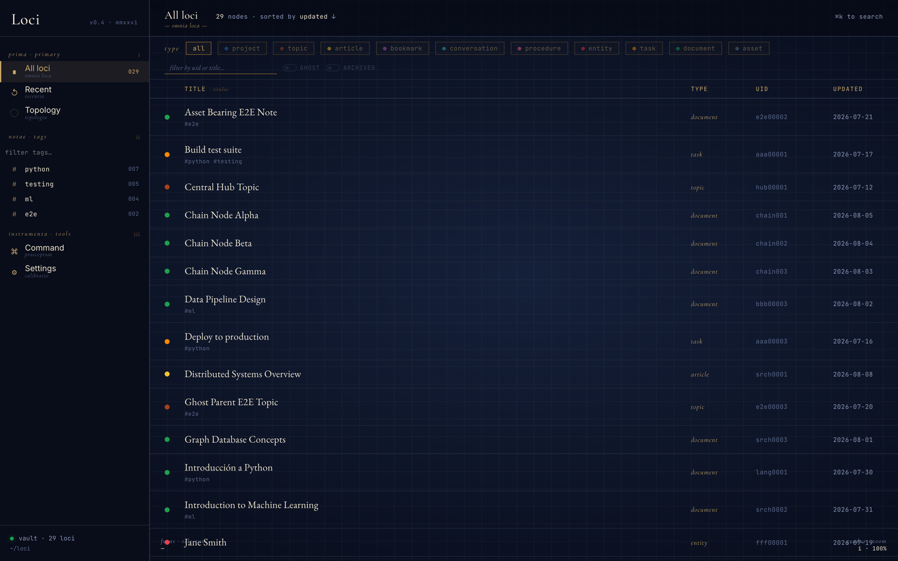
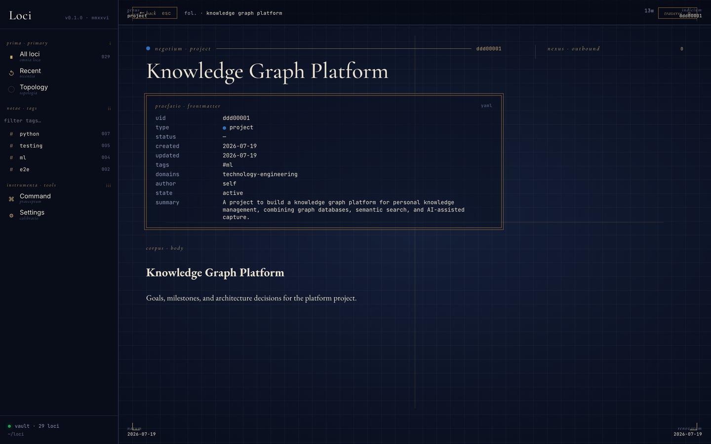
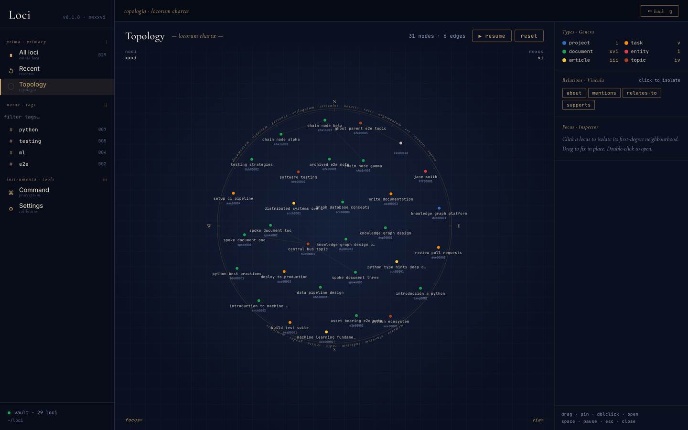
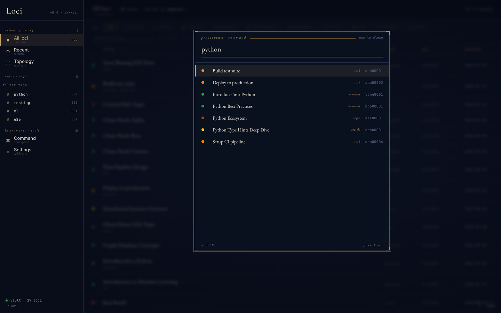

# Using Loci

## How to think about it

Loci is a memory, not a filing cabinet. The unit is a **node** — one Markdown
file with a stable UID, a type, and typed edges to other nodes — and the value
is in the edges. A note with no relationships is storage; a note that
`is-based-on` a book, `mentions` a person, and `belongs-to` a project is
something you can walk back to from any of those directions, the way the
method of loci walks a room.

Four habits follow from that:

1. **Capture at the moment, not later.** Edges are cheapest to record when the
   connection is still in your head. The `loci-save` skill suggests links on
   every save and asks you to confirm them, so the cleanup pass you would never
   get to happens at write time instead.
2. **Let the type do the sorting.** Every node is one of a small set of types
   (`document`, `article`, `task`, `asset`, `entity`, `log`, `topic`, …) with
   fields declared in a registry. Pick the type, and the fields, the folder,
   and how the UI shows it all follow. Tags are for cross-cutting labels, not
   for what a thing *is* — see [ontology.md](ontology.md).
3. **Point at things, don't move them.** A node can carry a location — a path,
   a drive, a URL, a mailbox — so a PDF stays where it is and the vault records
   that it exists and what it relates to. Copying everything into one folder
   is the old failure mode, not the goal.
4. **Ask questions, not searches.** "What do I know about stoicism?" should
   return the books, the reading logs, the notes, the people, and the paths
   between them. The `loci-query` skill traverses the graph; string search is
   the fallback, not the front door.

## Scenarios

The same vault, seen from the situations it is meant for:

| You are… | What you do | What Loci does |
|---|---|---|
| Reading something worth keeping | "Add this article to loci: <url>" | Fetches the metadata, classifies it, suggests links to what you already have, writes an `article` node |
| Having a thought mid-task | "Save this to my loci vault as a note: …" | Writes a `document` node, links it to the project or topic you were in |
| Starting or finishing a book | "Log a reading in loci: …" | The book is an `asset`; each reading is its own `log` node, so re-reads and changed opinions stay separate |
| Sitting on a backlog of files | Drop them in `loci-stage/`, "Process my loci inbox" | Plans the batch, asks for approval, ingests in resumable runs |
| Owning a folder you don't want to touch | "Ingest ~/Documents/papers into my loci vault" | Creates nodes that point at the files in place; nothing is copied |
| Trying to remember | "What does my loci vault know about X?" | Walks the graph and answers with the nodes and the paths between them |
| Changing your mind | Save the new position and say it supersedes the old one | Both survive; a `supersedes` edge records which way you moved |
| Browsing rather than asking | Start the UI (`loci`) | Filter by type and tag, read nodes, walk the topology, `⌘K` to jump |

The rest of this page is the mechanics of each; [examples.md](examples.md) is one prompt per scenario.

---

## Teach the agent once

Claude picks a skill from the wording of the request, and a bare "save this"
is ambiguous enough to land in a scratch file, another notes tool, or nowhere.
You can say "loci" or "my vault" every time, or tell it once what those words
mean to you. In Claude Code, add a line to `~/.claude/CLAUDE.md` (or type it
with a leading `#` in a session, which does the same thing):

```
When I say "save this", "remember this", "note this", "capture this", or "log
this", use the loci-save skill and write to my Loci vault — don't ask which
tool I mean. When I ask what I know about something, what's connected to it,
or what I saved recently, use the loci-query skill. Suggest links to existing
nodes on every save and confirm before writing.
```

In Claude Desktop or claude.ai, the same paragraph goes in the project's
instructions or your custom instructions. After that, the prompts in
[examples.md](examples.md) work as written, without naming the vault.

---

## Saving

Describe what you want to save, and **say "loci" or "my vault" in the request**:

```
Save this to my loci vault as a note: ...
Add this article to loci: https://example.com/article
Create a task in my vault: Review the Loci architecture by Friday
Save this entity to loci: John Smith, CEO at Acme Corp
```

Naming the vault routes the request to the `loci-save` skill, which reads the
ontology, classifies the type, generates frontmatter, suggests entity links,
and writes the file. [Teach the agent once](#teach-the-agent-once) and you can
drop the "loci".

### Querying

Same rule when reading back:

```
What does my loci vault know about stoicism?
What's connected to the Loci project in my vault?
What did I save to loci in the last two weeks?
How are these two vault notes related?
```

The `loci-query` skill uses the graph tools (`query_neighbors`, `query_related`, `query_path`, `find_nodes`, `search_vault`, `query_recent`, `query_insights`) rather than grepping files.

### Library

Track your ebook library as a knowledge graph. Books are saved as `asset` nodes with `subtype: book`; each time you read one, a `log` node (tagged `reading`) captures your notes, highlights, and rating, separately per reading, so re-reads are tracked independently.

```
Save this ebook to my loci library: Thinking, Fast and Slow by Kahneman
Log a reading in loci: I finished The Name of the Rose, 5/5, started March 1st
What does my vault know about stoicism? (finds books, reading logs, and connected topics)
```

### Inbox

Drop files into `loci-stage/` and run the inbox skill to process them in batches:

```
Process my loci inbox
```

The agent scans the staging folder, presents a plan with cost/time estimates, waits for your approval, then ingests files in configurable batch sizes (default: 50 ebooks per run, 10 text items per run; adjust `DEFAULT_BUDGET_FILES` / `DEFAULT_BUDGET_CONTENT` in `src/loci/tools/inbox_plan.py`). Progress is saved to `.inbox-plan.yaml` so sessions can be interrupted and resumed.

### Ingesting a directory in place

```
Ingest ~/Documents/papers into my loci vault
```

`scan_directory` catalogues files where they already live and the `loci-ingest-directory` skill creates nodes whose `has_asset` locations point at the original paths. Nothing is copied or moved.

---

## Customising the skills

Each skill has two halves. The packaged procedure ships inside Loci and is
replaced on every upgrade. Your additions live in the vault —
`<vault>/meta/loci-save-user.md`, `loci-query-user.md`, `loci-inbox-user.md`,
`loci-ingest-directory-user.md` — seeded once and never overwritten. Every
time a skill runs, the MCP server hands Claude the procedure with your file
appended, under a preamble that says how they combine: **your additions win
wherever they disagree with the procedure, except under headings marked 🔒**,
which hold no matter what you write. (The locked sections are the safety
rails — verify the vault first, ask before writing, never guess at intent.)

Add a rule the way you would tell a colleague:

```
From now on, when saving meeting notes, always tag them #meeting-notes and
link every attendee who has an entity node.
```

Claude writes it to the overlay with `write_skill`, and it is in force on the
next save — nothing to reinstall, nothing to restart. Rules that have earned
their place there look like:

```
- Bookmarks from arxiv.org are articles, not bookmarks — pull the abstract.
- This vault is work only: default `domains: [work]` unless I say otherwise.
- When I ask about a person, include their most recent log entries.
- Anything in `loci-stage/receipts/` is a `document` tagged #receipt; don't ask.
```

The file is plain Markdown, so you can also edit it by hand. Keep each rule
short and concrete: the model follows them verbatim, and a paragraph of
context is a paragraph it has to hold in its head on every run. To see what is
currently in force, ask Claude to read the skill — the additions are the last
section of what `read_skill` returns.

What goes where:

| You want to… | Put it in |
|---|---|
| Change how a skill behaves for you | the skill's `*-user.md` overlay |
| Add a type, relation, or scheme | `ontology-user.yaml` and friends — see below |
| Teach Claude which words mean "use Loci" | `~/.claude/CLAUDE.md` — see [above](#teach-the-agent-once) |

## Extending the ontology

The vocabulary comes in two layers, and the split is what lets Loci upgrade
without touching your work:

| Layer | Files in `<vault>/meta/` | Who writes it | On upgrade |
|---|---|---|---|
| **Canonical** | `ontology.yaml`, `relation-dictionary.yaml`, `scheme-dictionary.yaml` | Loci | Reseeded whenever `META_VERSION` moves — edits are overwritten |
| **Yours** | `ontology-user.yaml`, `relation-dictionary-user.yaml`, `scheme-dictionary-user.yaml`, `tag-dictionary.md` | You, or Claude on your behalf | Seeded once, never overwritten |

At startup the registries load the canonical file, then layer the user file on
top. The result is one vocabulary: a type you defined is validated on write,
checked by `lint_vault`, and offered to Claude exactly like a shipped one.

### Defining a type

Ask for it in plain words:

```
Define a `recipe` type in my loci vault that extends `procedure`, with
optional `servings` and `cuisine` fields.
```

Claude calls `validate_type`, then `define_type`, which appends the entry to
`ontology-user.yaml` and reloads the registry — the type is usable in the same
session, no restart. You can also edit the YAML by hand; it is picked up on
the next server start.

Three rules bound what a user type can be, and `define_type` refuses anything
outside them:

1. **It extends a canonical type.** `extends` must name one of the twelve
   shipped types, never another user type, so the hierarchy stays exactly one
   level deep and every note is still recognisably one of the base kinds.
2. **The name is new.** No collision with a canonical type or an existing
   user type.
3. **It only adds.** You may add fields and enum values; you cannot redefine
   or remove anything inherited.

The new type inherits every field of its parent and adds yours on top. A
`recipe` still requires `steps`, because a `procedure` does.

### Defining a relation or scheme

Same shape, fewer rules: the name must not collide, and that is all.

```
Define a `cooked-from` relation in my loci vault, inverse of `is-based-on`,
for a log that records making a recipe.
```

`define_relation` appends to `relation-dictionary-user.yaml`; an `inverse_of`
may point at a canonical relation. Schemes (where a file lives) go in
`scheme-dictionary-user.yaml`.

### How the two layers interact

- **Validation is one pass.** On write, an unknown type or relation is
  rejected whether the vocabulary you meant was canonical or yours; a known
  user type passes just like a shipped one.
- **Upgrades never touch your file, but they can move under it.** If a later
  release adds a canonical type or relation with the same name as one of yours,
  yours is skipped at load time (canonical wins) and the notes using it start
  failing validation as unknown. Release notes flag `META_VERSION` bumps for
  this reason; run `lint_vault` after one.
- **Invalid entries are skipped, not fatal.** A hand-edited entry that breaks a
  rule — extends a user type, redefines an inherited field — is dropped when
  the registry loads and the server carries on. Nothing announces it; the
  symptom is `lint_vault` reporting notes with an unknown type. Using
  `define_type` instead of editing by hand is how you avoid the silent case.
- **The web UI knows the canonical types only.** Its type filter bar and
  colour map are a fixed list, so a note of a user type is listed and readable
  but has no filter chip and no colour of its own. The MCP side has no such
  gap.
- **Tags are the cheap layer.** Before defining a type, ask whether a tag on
  an existing type would do. A type earns its keep when it needs a structured,
  queryable field (`servings`); if you only want to *find* your recipes,
  `#recipe` on a `procedure` is better. `tag-dictionary.md` is where the tag
  vocabulary lives, and it is yours too.

The full reference — every canonical type, relation, and scheme, and when each
rule is enforced — is the [ontology guide](../src/loci/skills/references/ontology-guide.md),
seeded into your vault at `meta/ontology-guide.md`. The repo-side view of the
registries is [ontology.md](ontology.md).

---

## The vault UI

A local React app for browsing the graph. Start both halves with one command:

```bash
make run          # your real vault:    API on :8765 + built UI on :4173
make dev          # scratch dev vault:  API on :8765 + Vite dev server on :5173
```

`make run` reads `~/.config/loci/config.yml` — the same vault the MCP server
serves. `make dev` deliberately does not; see [development.md](development.md#running).

The backend is `src/loci/http_server.py`, a thin FastAPI layer over the same `src/loci/api.py` facade the MCP server uses, so the UI can never drift onto a separate code path. It is read-only today (the API allows `GET` only); writes go through Claude.

### Vault index

Everything in the vault, filterable by type along the top and by tag down the left rail. Each row carries its type dot, tags, uid, and last-updated date.



### Node reader

Frontmatter rendered as a labelled grid rather than raw YAML, with the Markdown body below it. Nodes carrying an asset also show its resolved location and, for small text files, its inlined content.



### Topology

The graph as a force-directed map, coloured by type and filterable by relation. Click a node to isolate its first-degree neighbourhood, drag to pin, double-click to open. Space pauses the simulation.



### Command palette

`⌘K` from anywhere. Searches titles and summaries, showing type and uid per hit.



> These are captured from the e2e fixture vault, not a real one. `make screenshots` regenerates them.

---

## Vault Structure

The vault is **flat**: every node is a Markdown file at the vault root, named by a slug of its title (`why-i-left-twitter.md`). There are no per-type folders; type is frontmatter, and the graph index does the organizing. The only subdirectory is `meta/`.

```
~/loci/                              ← loci root (all stores are siblings)
  knowledge-vault/                   ← knowledge graph, markdown only
    <slug>.md                        ← one file per node, flat
    meta/
      ontology.yaml                  ← machine-readable type system   (reseeded on META_VERSION bump)
      ontology-user.yaml             ← user-defined type extensions   (user-owned)
      relation-dictionary.yaml       ← machine-readable relations     (reseeded)
      relation-dictionary-user.yaml  ← user-defined relations         (user-owned)
      scheme-dictionary.yaml         ← location scheme vocabulary     (reseeded)
      scheme-dictionary-user.yaml    ← user-defined schemes           (user-owned)
      type-dictionary.md             ← human-readable type vocabulary (reseeded)
      field-dictionary.md            ← field definitions per type     (reseeded)
      tag-dictionary.md              ← freeform tag vocabulary        (user-owned)
      relation-dictionary.md         ← human-readable relation guide  (reseeded)
      foreign-definitions.md         ← external source schemas        (user-owned)
      .meta-version                  ← which META_VERSION this vault was seeded at

  assets/                       ← binary/rich files adopted into the vault
    <uid>.<ext>                 ← one file per asset, named by vault node UID
    .pending/                   ← intent files for crash recovery during writes

  loci-stage/                   ← staging inbox, drop files here for batch ingestion
    .inbox-plan.yaml            ← work queue written by scan_inbox, consumed by execution
```

`assets/` and `loci-stage/` are **siblings** of the vault, not inside it. The vault directory holds `.md` files only. See [docs/file-saving.md](file-saving.md) for the full write sequence.

### Assets and locations

A node points at its underlying files through the `has_asset` frontmatter list. Each entry is a format with one or more candidate locations:

```yaml
has_asset:
  - format: epub
    primary: true
    locations:
      - scheme: local
        path: assets/56bb363e.epub
      - scheme: google-drive
        file_id: 1AbCdEf…
```

`resolve_asset` walks the locations in order and returns the first one that resolves. Schemes are declared in `scheme-dictionary.yaml` and validated on write; `local` and `url` fetch content directly, while cloud and remote schemes (`google-drive`, `nextcloud`, `gmail`, `onedrive`, `dropbox`, `icloud-drive`, `s3`, `ssh-remote`) resolve to a pointer that the appropriate MCP or native tool opens. `find_nodes(has_asset_scheme=…)` filters the graph by scheme.

This replaced the separate `asset-registry/` YAML store (locations refactor, Phase 5). Location data now lives in the node's own frontmatter. `vault_init` still creates a legacy `asset-registry/` directory, but nothing in the save path writes to it.
